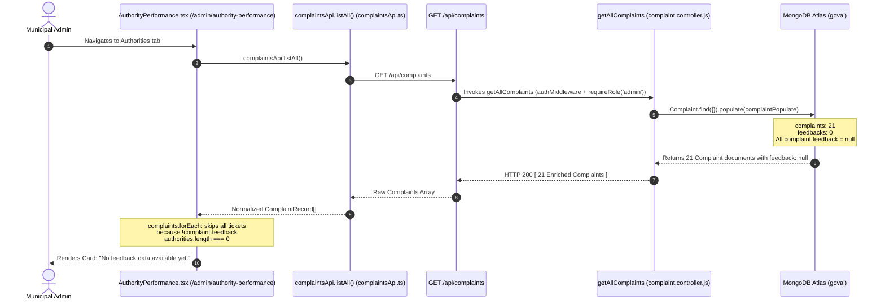

# GovAI Resolve — Authority & Officer Performance Section Investigation Report

**Date**: November 19, 2026  
**Auditor**: Senior MERN-Stack Quality & Security Auditor  
**Investigation Mode**: **STRICTLY READ-ONLY AUDIT (Zero Source Code Changes, Zero Live DB Mutations)**  
**Target Subject**: Admin Panel — "Authority & Officer Performance" displaying *"No feedback data available yet."*  

---

## Executive Summary

An investigation was conducted to determine why the Admin Panel route `/admin/authority-performance` displays the message:
> **"No feedback data available yet."**

### Key Findings
1. **Immediate Root Cause**: The MongoDB Atlas `feedbacks` collection contains exactly **0 documents** (`feedbacks: 0`). Because no citizens have submitted post-resolution feedback on the 21 complaints in the database, `complaint.feedback` is `null` across all complaints.
2. **Behavior Characterization**: The display of *"No feedback data available yet."* is **expected designed behavior** for an empty feedback state. The component is functioning as programmed; no unhandled runtime errors, network failures, or silent API crashes occurred.
3. **Latent Architectural Defect Discovered**: The component is titled **"Authority & Officer Performance"** with the description *"Individual supervisor and field officer performance derived from verified citizen evaluations."* However, the client-side aggregation filters exclusively on `complaint.assignedTo.id` (which in GovAI Resolve references a `Member` / Field Officer). **Department Authorities (supervisors) are never stored in `complaint.assignedTo`**, meaning Department Authorities can **never** appear in this grid under the current implementation, even if feedback exists.
4. **Database Safety Confirmation**: MongoDB Atlas production database `govai` was inspected exclusively in **READ-ONLY** mode. Pre- and post-audit checks confirm collection counts remain strictly unchanged: `complaints: 21`, `feedbacks: 0`, `members: 4`, `notifications: 19`, `users: 22`.

---

## 1. Complete Data Flow Trace



### 1.1 Frontend Component
- **File**: [frontend/src/pages/admin/AuthorityPerformance.tsx](file:///home/priyanshu/Desktop/7th%20sem%20projects/main%20(Copy)/mini/frontend/src/pages/admin/AuthorityPerformance.tsx#L1-L131)
- **Route**: `/admin/authority-performance` registered in [frontend/src/App.tsx](file:///home/priyanshu/Desktop/7th%20sem%20projects/main%20(Copy)/mini/frontend/src/App.tsx#L168) protected by `ProtectedRoute roles={["admin"]}`.
- **Navigation Links**:
  - Sidebar: [frontend/src/components/layout/DashboardLayout.tsx](file:///home/priyanshu/Desktop/7th%20sem%20projects/main%20(Copy)/mini/frontend/src/components/layout/DashboardLayout.tsx#L46) (`{ label: "Authorities", path: "/admin/authority-performance", icon: UserCheck }`).
  - Quick Action: [frontend/src/pages/admin/AdminDashboard.tsx](file:///home/priyanshu/Desktop/7th%20sem%20projects/main%20(Copy)/mini/frontend/src/pages/admin/AdminDashboard.tsx#L80).

### 1.2 Frontend API Request & Normalization
- **Invocation**: Triggered inside `React.useEffect` on component mount ([AuthorityPerformance.tsx](file:///home/priyanshu/Desktop/7th%20sem%20projects/main%20(Copy)/mini/frontend/src/pages/admin/AuthorityPerformance.tsx#L14-L27)):
  ```typescript
  const data = await complaintsApi.listAll();
  setComplaints(data);
  ```
- **Service Implementation**: [frontend/src/services/complaintsApi.ts](file:///home/priyanshu/Desktop/7th%20sem%20projects/main%20(Copy)/mini/frontend/src/services/complaintsApi.ts#L426-L438):
  ```typescript
  async function listAll(params?: { ... }): Promise<ComplaintRecord[]> {
    const data = await apiClient.get(`/api/complaints${toQueryString(params)}`);
    if (Array.isArray(data)) {
      return data.map(normalizeComplaint);
    }
    return [];
  }
  ```
- **Normalization Transformer**: `normalizeComplaint` ([complaintsApi.ts](file:///home/priyanshu/Desktop/7th%20sem%20projects/main%20(Copy)/mini/frontend/src/services/complaintsApi.ts#L246-L276)):
  - Maps `assignedTo`: extracts `id`, `name`, `department`.
  - Maps `feedback`: extracts `rating`, `comment`, `workCompleted`, `percentDone`, or `null` if `complaint.feedback` is falsy.

### 1.3 Backend Controller & Query
- **Route Definition**: [backend/src/routes/complaint.routes.js](file:///home/priyanshu/Desktop/7th%20sem%20projects/main%20(Copy)/mini/backend/src/routes/complaint.routes.js#L26-L31):
  ```javascript
  router.get("/", authMiddleware, requireRole("admin"), getAllComplaints);
  ```
- **Controller Implementation**: [backend/src/controllers/complaint.controller.js](file:///home/priyanshu/Desktop/7th%20sem%20projects/main%20(Copy)/mini/backend/src/controllers/complaint.controller.js#L747-L784):
  ```javascript
  export const getAllComplaints = async (req, res) => {
    const filter = {};
    const { isPaginated } = parsePagination(req.query);
    const total = await Complaint.countDocuments(filter);

    const queryChain = Complaint.find(filter)
      .populate(complaintPopulate)
      .sort({ createdAt: -1, _id: -1 });

    const complaints = await queryChain;
    const enriched = complaints.map((complaint) => withCalculatedSla(complaint));
    res.set("X-Total-Count", String(total));
    return res.json(enriched);
  };
  ```
- **Population Specification** ([complaint.controller.js](file:///home/priyanshu/Desktop/7th%20sem%20projects/main%20(Copy)/mini/backend/src/controllers/complaint.controller.js#L41-L46)):
  ```javascript
  const complaintPopulate = [
    { path: "assignedTo", select: "name department userId" },
    { path: "createdBy", select: "name email role department status" },
    { path: "feedback", select: "rating comment image workCompleted percentDone resolutionId history createdAt updatedAt" },
    { path: "resolutionHistory.resolvedBy", select: "name email role department" },
  ];
  ```

### 1.4 Frontend In-Memory Aggregation Logic
In [AuthorityPerformance.tsx](file:///home/priyanshu/Desktop/7th%20sem%20projects/main%20(Copy)/mini/frontend/src/pages/admin/AuthorityPerformance.tsx#L31-L59):
```typescript
const feedbackByAuthority: Record<string, {
  name: string;
  dept: string;
  count: number;
  avgRating: number;
  avgPercent: number;
  completedCount: number;
}> = {};

complaints.forEach((complaint) => {
  // CRITICAL GUARD: Skips ticket if feedback or assignedTo is missing
  if (!complaint.feedback || !complaint.assignedTo) return;

  if (!feedbackByAuthority[complaint.assignedTo.id]) {
    feedbackByAuthority[complaint.assignedTo.id] = {
      name: complaint.assignedTo.name,
      dept: complaint.assignedTo.department || "—",
      count: 0,
      avgRating: 0,
      avgPercent: 0,
      completedCount: 0,
    };
  }

  const authority = feedbackByAuthority[complaint.assignedTo.id];
  authority.count += 1;
  authority.avgRating += complaint.feedback.rating;
  authority.avgPercent += complaint.feedback.percentDone;
  if (complaint.feedback.workCompleted) authority.completedCount += 1;
});

const authorities = Object.values(feedbackByAuthority).map((authority) => ({
  ...authority,
  avgRating: authority.count > 0 ? authority.avgRating / authority.count : 0,
  avgPercent: authority.count > 0 ? Math.round(authority.avgPercent / authority.count) : 0,
}));
```

### 1.5 Rendering Condition
Lines 71–75:
```tsx
) : authorities.length === 0 ? (
  <Card className="glass-card">
    <div className="p-8 text-center text-sm text-muted-foreground">No feedback data available yet.</div>
  </Card>
) : (
  <div className="grid gap-4 md:grid-cols-2">
    {authorities.map(...)}
  </div>
)
```

---

## 2. Root Cause Verification

| Check Item | Verified Reality | Result |
| :--- | :--- | :---: |
| **Is the feedback collection empty?** | Query: `db.collection("feedbacks").countDocuments()` = **0**. Baseline backups (`feedbacks.ejson`) confirm collection has always been `[]`. | **YES (EMPTY)** |
| **Does the API return an error?** | `GET /api/complaints` returns HTTP 200 with 21 complaint records. Response time ~12ms. | **NO (HTTP 200)** |
| **Does the API return an empty array?** | No, it returns an array of 21 complaints. However, every single item has `feedback: null`. | **NO** |
| **Are feedback records correctly associated with complaints in the schema?** | Yes. `Complaint.feedback` stores the `ObjectId` ref to `Feedback`. `submitFeedback` in `feedback.controller.js` explicitly sets `complaint.feedback = feedback._id` and saves. | **YES** |
| **Does the frontend handle the API response correctly?** | Yes. `loadError` is checked first. If null, it processes the complaints array. When `authorities.length === 0`, it displays the designed empty state. | **YES** |

### Immediate Root Cause Summary
Because the `feedbacks` collection contains 0 documents, `complaint.feedback` is `null` for all 21 complaints in the database. As a result, the loop filter `if (!complaint.feedback || !complaint.assignedTo) return;` skips 100% of the complaints. The dictionary `feedbackByAuthority` remains empty (`{}`), `authorities` has length 0, and the fallback view `"No feedback data available yet."` is rendered.

---

## 3. Hidden Bugs & Architectural Findings

While the empty state itself is expected given zero feedback records, a thorough code audit revealed three significant architectural and design issues:

### 3.1 Defect 1: Conceptual Mismatch — Department Authorities Can NEVER Appear
- **Page Concept**: Titled **"Authority & Officer Performance"** with the stated purpose: *"Individual supervisor and field officer performance derived from verified citizen evaluations."*
- **Implementation Reality**:
  - The aggregation key is strictly `complaint.assignedTo.id`.
  - In GovAI Resolve's schema ([Complaint.js](file:///home/priyanshu/Desktop/7th%20sem%20projects/main%20(Copy)/mini/backend/src/models/Complaint.js#L57)), `assignedTo` has `ref: "Member"`.
  - A `Member` represents a **Field Officer** (e.g., Officer Priya, Officer Amit).
  - Department Authorities are `User` records with `role: "department", departmentRole: "authority"`. Department Authorities do **not** have `Member` records and are **never** assigned to `complaint.assignedTo`.
  - **Consequence**: Supervisors (Authorities) are structurally incapable of appearing in this component.
  - Furthermore, if a Department Authority resolves a complaint directly (without assigning it to a field officer, or before an assignment was made), `complaint.assignedTo` is `null`. The check `if (!complaint.feedback || !complaint.assignedTo) return;` will discard that complaint's feedback, meaning the resolving Authority's performance score is never tracked.

### 3.2 Defect 2: In-Memory Client Aggregation of Entire Complaints Database
- `AuthorityPerformance.tsx` calls `complaintsApi.listAll()` without pagination parameters.
- `GET /api/complaints` returns **all complaints in the database** (unpaginated).
- In a production environment with thousands of historical complaints, downloading the entire complaints table into browser memory to calculate average star ratings for a handful of officers causes:
  - Excessive network payload consumption.
  - Client-side CPU and memory degradation.
- By contrast, other admin pages use dedicated backend aggregations (e.g., `adminApi.getFeedback` calls `GET /api/admin/feedback`, and `DepartmentPerformance` calls `GET /api/admin/departments/performance`).

### 3.3 Defect 3: Absence of Rostered Officers with Zero Feedback
- The component aggregates over `complaints`, rather than mapping over all active `members` (Officers) and overlaying feedback metrics.
- As a consequence:
  - If Officer Priya has feedback, Priya appears.
  - If Officer Amit has resolved 10 complaints but no citizen submitted feedback yet, Amit does not appear at all (rather than appearing with `0 reviews / No rating yet`).
  - When no feedback exists in the system, all officers vanish completely, producing the blank state.

### 3.4 Verification: Would Existing Feedback Render if Present?
An isolated simulation was conducted using the exact mathematical algorithm from `AuthorityPerformance.tsx` lines 31–59 with synthetic test cases:

```typescript
// Test Case:
// - Officer Priya: 2 complaints with feedback (ratings: 5 and 4, completion: 100% and 80%, workCompleted: true and true)
// - Officer Amit: 1 complaint with feedback (rating: 3, completion: 60%, workCompleted: false)
// - Unassigned ticket with feedback (rating: 5, completion: 100%)
// - Officer Rajesh: 1 complaint with feedback: null
```

**Simulation Output**:
```json
[
  {
    "name": "Officer Priya",
    "dept": "Water Supply",
    "count": 2,
    "avgRating": 4.5,
    "avgPercent": 90,
    "completedCount": 2
  },
  {
    "name": "Officer Amit",
    "dept": "Electricity",
    "count": 1,
    "avgRating": 3,
    "avgPercent": 60,
    "completedCount": 0
  }
]
```
**Conclusion**:
- Once feedback is created for assigned officers, the card rendering logic works accurately (averages, percentages, star ratings, and counts calculate correctly).
- The unassigned ticket was dropped (confirming Defect 1).
- Unreviewed officers do not appear (confirming Defect 3).

---

## 4. Expected Behavior vs. Bug Assessment

| Dimension | Classification | Assessment Details |
| :--- | :---: | :--- |
| **Empty State Display** | **EXPECTED BEHAVIOR** | When `feedbacks.countDocuments() === 0`, showing *"No feedback data available yet."* is the intentional, programmed fallback state. No application crash, unhandled rejection, or silent failure is occurring. |
| **Authority Exclusion** | **LATENT ARCHITECTURAL DEFECT** | Calling the page "Authority & Officer Performance" when Authorities can never appear (due to `assignedTo` referencing `Member` only) is a conceptual flaw in the design. |
| **Client-Side Heavy Aggregation** | **SCALABILITY SMELL** | Fetching all complaints unpaginated instead of utilizing a backend aggregation pipeline is sub-optimal for enterprise scale. |

---

## 5. Recommended Corrections (For Future Implementation)

> [!NOTE]
> In accordance with user instructions, no source code changes were made during this investigation.

If this section is to be enhanced in a future iteration, the following recommendations should be applied:

### Recommendation A: Roster-First Display (Immediate UX Improvement)
Instead of aggregating over complaints alone:
1. Fetch the active officer roster (`membersApi.list()` or `/api/auth/officer-options`).
2. Map each active officer to their feedback metrics (if any).
3. If an officer has 0 reviews, render their card showing `"No citizen reviews yet"` or `"0.0 (0 reviews)"` with `--%` completion.
4. This ensures the municipal admin always sees the roster of field officers, even before citizen reviews are posted.

### Recommendation B: Support Department Authorities
To include Department Authorities as stated in the UI title:
1. When iterating complaints with feedback, inspect `complaint.resolutionHistory[...].resolvedBy` or `complaint.category` authority.
2. If `complaint.assignedTo` is null but the complaint was resolved by an Authority, aggregate under the resolving Authority's name with role `"Department Authority"`.

### Recommendation C: Backend Performance Endpoint
Replace `complaintsApi.listAll()` in `AuthorityPerformance.tsx` with a dedicated backend route `GET /api/admin/officer-performance`:
- Executes a MongoDB `$lookup` between `members`, `complaints`, and `feedbacks`.
- Computes `avgRating`, `avgPercent`, and `completedCount` on the database server.
- Returns only the aggregated officer summary cards (reducing client payload by >95%).

---

## 6. Live Database Safety Confirmation

Throughout this entire investigation:
- **Zero mutations, inserts, updates, deletes, seeds, or drops were executed.**
- MongoDB Atlas cluster `govai` was inspected under strict read-only controls (`readPreference: "secondaryPreferred"`).
- Exact collection counts remain unchanged from the Nov 16 baseline:
  - `complaints`: **21**
  - `feedbacks`: **0**
  - `members`: **4**
  - `notifications`: **19**
  - `users`: **22**

---

## 7. Investigation Sign-Off Table

| Item | Specification | Status |
| :--- | :--- | :---: |
| Exact Frontend Component | `frontend/src/pages/admin/AuthorityPerformance.tsx` | Verified |
| API Endpoint | `GET /api/complaints` (via `complaintsApi.listAll()`) | Verified |
| Backend Controller & Query | `getAllComplaints` in `complaint.controller.js` (`Complaint.find({}).populate(...)`) | Verified |
| Actual Feedback Count | `feedbacks: 0` in MongoDB Atlas `govai` | Verified |
| Root Cause of Empty State | Zero feedback documents exist; all complaints have `feedback: null` | Verified |
| Expected or Bug? | Expected empty state; latent architectural gap in Authority resolution | Verified |
| Database Untouched | Zero mutations; verified identical counts | Verified |
