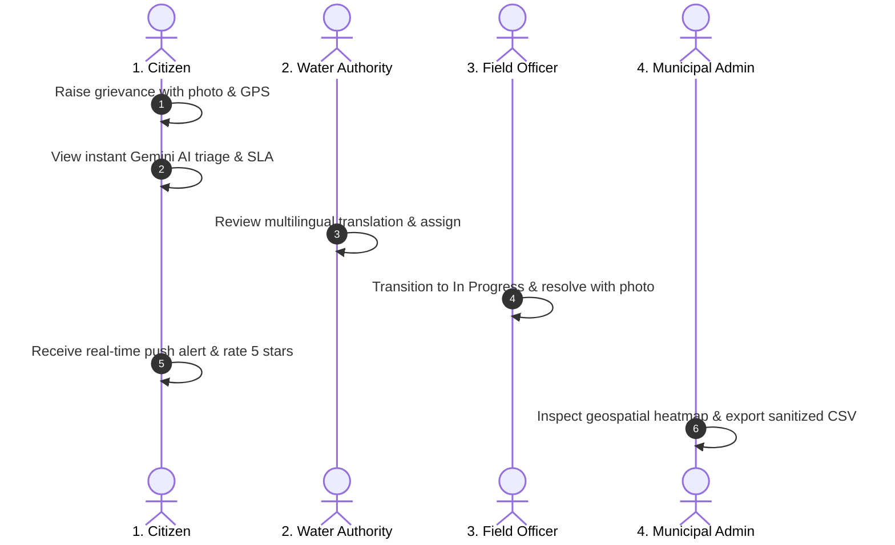

# GovAI Resolve: Live Demonstration & Viva Evaluation Guide
## Step-by-Step 10-Minute Presentation Script & Operational Walkthrough

**Target Environment**: Localhost (`http://localhost:8080` Frontend, `http://localhost:5000` Backend)  
**Database**: Isolated Test Database (`govai_phase8_5_test`) or Localhost Development Instance  
**Recommended Duration**: 10–12 Minutes  

---

## 1. Pre-Demonstration Checklist

Before inviting evaluators or commencing the presentation, complete this 2-minute preflight check:

1. **Verify Backend API**:
   ```bash
   curl -s http://localhost:5000/health
   # Expected Output: {"status":"ok","database":"connected"}
   ```
2. **Verify Frontend UI**:
   - Open browser tab at `http://localhost:8080`.
   - Ensure the landing page loads cleanly with the "GovAI Resolve" brand banner and demo buttons.
3. **Verify Google Gemini API Key**:
   - Ensure `GEMINI_API_KEY` is active in `backend/.env`. (If offline or quota exceeded, the app safely falls back to standard Medium SLA without errors).
4. **Prepare Two Browser Windows / Tabs**:
   - **Tab 1**: Primary demonstration tab (Citizen / Authority / Officer).
   - **Tab 2**: Secondary observation tab (Citizen notification receiver or Admin dashboard) to showcase **real-time Socket.IO WebSocket synchronization**.

---

## 2. Demonstration Accounts & Quick Pre-fills

In development mode on `http://localhost:8080/login`, one-click demo buttons are provided below the login form. Clicking any role button automatically fills the credentials:

| Role | Demo Button Label | Demo Email | Department Scope |
| :--- | :--- | :--- | :--- |
| **Citizen** | `Citizen Demo` | `citizen.demo@govai.gov` | Public Citizen Dashboard (`/citizen`) |
| **Department Authority** | `Water Supply Authority` | `water@demo.com` | Water Supply Management (`/department`) |
| **Field Officer** | `Water Officer` / Linked | `officer.rajesh@govai.gov` | Assigned Work Queue (`/department/my-assigned`) |
| **Municipal Admin** | `Admin Demo` | `admin@govai.gov` | Executive Municipal Suite (`/admin`) |

---

## 3. The 10-Minute Demonstration Flow



---

### Act 1: The Citizen Experience — Submission & AI Triage (3 Minutes)

#### Objective
Demonstrate natural language complaint submission, photo attachment, automatic geolocation, and instant generative AI classification.

1. **Navigate to Login**:
   - Go to `http://localhost:8080/login`.
   - Click the **"Citizen Demo"** button (pre-fills `citizen.demo@govai.gov`).
   - Click **"Sign In as Citizen"**.
2. **Raise a Grievance**:
   - Navigate to `/citizen/new` (or click **"Raise Complaint"**).
   - Enter Complaint Title:
     > *"Severe drinking water contamination and pipe leak near residential sector"*
   - Enter Description (or test multilingual capability):
     > *"नल से बहुत गंदा और बदबूदार पानी आ रहा है। मुख्य पाइपलाइन में लीकेज है और सड़क पर पानी बह रहा है।"*
     *(Tap water is foul and muddy. Main pipeline is leaking).*
   - Select Category: `Water Supply`.
   - Observe Geolocation: The app automatically populates latitude and longitude (`12.9785`, `77.6415`) via browser geolocation.
   - Upload Evidence Photo: Attach a sample pipe/water image (drag and drop).
   - Click **"Submit Complaint"**.
3. **Show Evaluators the Instant AI Outcome**:
   - The complaint is created and routed immediately to `/citizen/complaints`.
   - Point out:
     - **Status Badge**: `Pending`.
     - **Gemini AI Analysis**: Automatically assigned `Water Supply` category and evaluated urgency as `High` or `Critical`.
     - **Dynamic SLA**: Response deadline calculated for 48 hours.

---

### Act 2: Department Authority — Triage, Translation & Delegation (2.5 Minutes)

#### Objective
Demonstrate multi-tenant department isolation, multilingual translation, and field officer delegation.

1. **Log in as Authority**:
   - Log out of Citizen and return to `/login`.
   - Click **"Water Supply Authority"** (pre-fills `water@demo.com`).
   - Click **"Sign In as Authority"**.
2. **Inspect Multi-Tenant Queue**:
   - Navigate to `/department/assigned`.
   - **Key Point for Evaluators**: Note that Water Authority sees **only** Water Supply complaints. Roads, Electricity, and Environment complaints are completely hidden.
3. **Open Complaint Detail (`/department/complaints/:id`)**:
   - Click on the newly raised complaint.
   - **Highlight Gemini AI Translation**:
     - Point out the **"Detected language: Hindi (Devanagari)"** badge.
     - Show the **"English translation"**: *"Very dirty and foul-smelling water coming from tap..."*.
     - Show Gemini's **"Recommended Action"**: *"Dispatch field technician to isolate line and test water quality"*.
4. **Delegate to Field Officer**:
   - Under the **"Assign Officer"** section, select **"Officer Rajesh"** from the dropdown.
   - Click **"Confirm Assignment"**.
   - Status updates instantly to `Assigned`, and an audit event is appended to the operational timeline.

---

### Act 3: Field Officer — Investigation & Evidence Resolution (2.5 Minutes)

#### Objective
Demonstrate the isolated field officer queue and mandatory photographic proof of resolution.

1. **Log in as Field Officer**:
   - Switch to or log in as **Officer Rajesh** (`officer.rajesh@govai.gov`).
2. **Inspect Assigned Work Queue**:
   - Navigate to `/department/my-assigned`.
   - **Key Point for Evaluators**: Officer Rajesh sees **only** complaints assigned directly to him.
3. **Commence Investigation**:
   - Change status dropdown from `Assigned` to **`In Progress`**.
   - Show that the timeline logs the operational transition.
4. **Resolve Complaint with Proof**:
   - Click **"Resolve Complaint"**.
   - The `ResolveComplaintDialog` modal opens.
   - Enter Resolution Remarks:
     > *"Repaired main valve gasket, flushed 200 meters of distribution line, and verified water clarity samples."*
   - Upload Resolution Photo: Attach an after-repair photo.
   - Click **"Confirm Resolution"**.
   - Status transitions to `Resolved`. The SLA countdown clock stops and records `resolvedAt`.

---

### Act 4: Citizen Verification & Satisfaction Feedback (1.5 Minutes)

#### Objective
Demonstrate real-time WebSocket notifications, evidence comparison lightbox, and feedback evaluation.

1. **Switch Back to Citizen Tab**:
   - View the header notification bell: Point out the unread badge increment.
   - Open notification drawer: Observe instant alert: *"Your complaint CMP-... has been marked as Resolved"*.
2. **Open Complaint Details**:
   - Click on the resolved complaint card.
   - Open the **Evidence Lightbox Viewer**:
     - Display the original defect photo alongside the officer's verified repair photo.
3. **Submit Citizen Satisfaction Feedback**:
   - Scroll to the Feedback section.
   - Select **5 Stars** rating.
   - Enter Comments: *"Fast response and clean repair work. Thank you!"*
   - Click **"Submit Feedback"**.
   - Feedback is saved to MongoDB, closing the accountability loop.

---

### Act 5: Executive Administration — Geospatial Heatmap & Analytics (2.5 Minutes)

#### Objective
Showcase executive oversight, geospatial intelligence, privacy protection, and formula-safe data exports.

1. **Log in as System Admin**:
   - Return to `/login` and click **"Admin Demo"** (`admin@govai.gov`).
   - View `/admin` Overview: Point out system health, active department count, and resolution velocity metrics.
2. **Inspect Interactive Geospatial Heatmap (`/admin/heatmap`)**:
   - Open the Heatmap page.
   - Show the SVG vector map plotting complaint GPS pins.
   - Click on a **numeric cluster marker**:
     - The cluster popover displays complaint IDs, categories, and dates.
     - **Highlight Privacy Compliance**: Point out the notice: *"Citizen personal identity details are protected under municipal privacy compliance"*.
3. **Inspect Advanced Analytics (`/admin/analytics`)**:
   - Show monthly complaint volume bar charts, resolution percentages, and SLA compliance gauges.
4. **Demonstrate Formula-Safe Data Export (`/admin/reports`)**:
   - Navigate to `/admin/reports`.
   - Filter by Department: `Water Supply`.
   - Click **"Export CSV"**.
   - Explain to evaluators: All exported fields are sanitized against **CSV Formula Injection (CWE-1236)**, preventing spreadsheet execution exploits.
5. **Demonstrate GovAI Assistant Chatbot**:
   - Click the floating chatbot in the lower-right corner.
   - Ask: *"What is the backlog in the Water Supply department?"*
   - Show Gemini generating an accurate natural-language response based on live MongoDB records.

---

## 4. Key Talking Points for Evaluators

When explaining the system to professors or examiners, emphasize these architectural achievements:
1. **End-to-End MERN Integration**: Not a mockup—every form, modal, and button communicates with real Express routes and MongoDB Atlas collections.
2. **Decoupled AI Reliability**: If Google Gemini is unreachable or internet drops, the system **never crashes**; complaints persist with baseline SLAs, and retry buttons permit administrative re-evaluation.
3. **Cryptographic Upload Security**: Magic-byte binary file validation defends against executable disguise attacks, and path traversal guards ensure files cannot escape upload roots.
4. **Enterprise Database Design**: MongoDB compound indexes on high-frequency paths ensure sub-200ms query performance regardless of dataset size.
5. **Real-Time Cross-Device Sync**: Socket.IO authenticated rooms deliver immediate synchronization across separate tabs and devices without polling.

---

## 5. Demonstration Troubleshooting & Quick Fixes

| Issue Encountered | Root Cause | Instant Fix During Demo |
| :--- | :--- | :--- |
| **"Failed to fetch" on frontend** | Backend process is not running on port 5000 | In backend terminal: `npm run dev` |
| **Login button disabled** | Incomplete credentials entered | Use the one-click demo pre-fill buttons at the bottom of the login form |
| **AI analysis status is "failed"** | `GEMINI_API_KEY` invalid or internet disconnected | Explain the **fault-tolerant fallback**: the complaint still created with standard 72h SLA |
| **Port 5000 / 8080 already in use** | A dangling process from a previous test is running | Run `fuser -k 5000/tcp` and `fuser -k 8080/tcp` before restarting |
| **Cluster popover doesn't open** | Zoomed too far out on map | Click directly on the numeric circle marker or use the map zoom controls |
