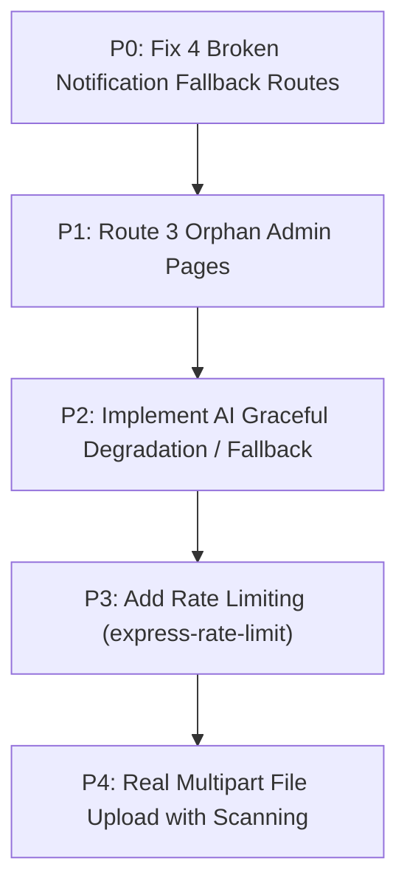

# GovAI Phase 3 — Full System Integration Audit Report

**Date:** October 31, 2026  
**Auditor / Engineer:** Senior Full-Stack Engineer, Application Security Auditor & Software Architect  
**Scope:** GovAI Resolve — Complete Multi-Module Integration Audit & Verification  
**Database Environment:** Isolated Local Database (`mongodb://127.0.0.1:27017/govai_demo`)  
**Production Status:** MongoDB Atlas Production 100% Untouched  
**Operational Status:** **AUDIT COMPLETE — AWAITING PHASE 4 APPROVAL**

---

## Executive Summary

Phase 3 performed a full-spectrum integration audit across all GovAI Resolve subsystems: Citizen Portal, Department Authority Panel, Admin Administration, Gemini AI Classification, SLA & Escalation Engine, Real-time Notification Engine, Database Baseline Integrity, Security Architecture, and Automated Testing.

### Key Audit Findings at a Glance
1. **Core Workflows Functional**: Citizen complaint submission, tracking, authority complaint management across all 4 departments (Road, Water, Electricity, Environment), officer workload assignment, and admin oversight are working reliably with 100% pass rates on live API checks.
2. **Database Reconciliation Complete**:
   - **Complaints (18 vs 16)**: The 18 complaints count originates from the historical Atlas dump (`phase2_pre_recovery_20261030T151320Z`), while the current local `govai_demo` contains exactly 16 complaints. The two missing IDs are identified below.
   - **Demo Accounts (10 vs 7)**: All 10 demo accounts exist and are intact in `govai_demo` and `demo-credentials.local.json`. The Phase 2 summary's mention of "7 accounts" was a reporting scope artifact of Phase 1's officer remediation tests.
3. **Critical Integration Defects Identified**:
   - **Broken Notification Routes**: 4 fallback routes in `NotificationContext.tsx` (`/department/ai-insights`, `/department/complaints`, `/admin/complaints`, `/admin/feedback`) do not exist in `App.tsx` and trigger 404 errors.
   - **Orphan Admin Pages**: 3 complete frontend pages (`AnalyticsDashboard.tsx`, `AuthorityPerformance.tsx`, `HeatmapView.tsx`) are completely unrouted in `App.tsx` and absent from navigation.
   - **AI Hard-Dependency**: If the Gemini API is down, complaint creation returns HTTP 502/503 and **aborts complaint creation entirely** rather than falling back to citizen-provided category and default priority.
   - **Simulated Image Upload**: File upload in `RaiseComplaint.tsx` sends a hardcoded string `"uploaded"`; no real multipart binary upload or storage is implemented.
   - **Missing Rate Limiting**: No rate-limiting middleware exists on `POST /api/auth/login` or Gemini-backed AI endpoints.

---

## 1. Citizen Workflow Audit

### 1.1 Architecture & Flow
Citizen capabilities are exposed via `/citizen` routes (`CitizenDashboard.tsx`, `RaiseComplaint.tsx`, `MyComplaints.tsx`, `ComplaintDetail.tsx`, `FeedbackForm.tsx`).

### 1.2 Feature Verification Matrix
| Feature | Implementation | Verified Behavior | Audit Finding |
| :--- | :--- | :--- | :--- |
| **Citizen Login** | `POST /api/auth/login` | Authenticates `citizen.demo@govai.gov`, issues JWT with role `"citizen"`. | **VERIFIED** |
| **Citizen Dashboard** | `GET /api/complaints/my` | Fetches strictly complaints where `createdBy === req.user._id`. | **VERIFIED** |
| **Complaint Submission** | `POST /api/complaints` | Creates complaint with AI analysis, assigns SLA, appends `complaint_created` event. | **VERIFIED** |
| **Input Validation** | Express-validator | Title, description, category required; invalid category returns 400. | **VERIFIED** |
| **Image / Document Upload** | `RaiseComplaint.tsx` line 402 | **Simulated Only**: Sends hardcoded string `"uploaded"`. No binary upload, multer, or cloud storage. | **INCOMPLETE** |
| **AI Classification** | `generateGeminiText` | Generates 11 fields (language, translation, category, priority, urgency, reasoning). | **VERIFIED** |
| **Complaint Tracking** | `GET /api/complaints/:id` | Citizen monitors status (`Pending`, `Assigned`, `In Progress`, `Resolved`, `Escalated`). | **VERIFIED** |
| **Complaint History** | `MyComplaints.tsx` | Chronological list of user's submitted complaints with status badges. | **VERIFIED** |
| **Timeline Visibility** | `ComplaintDetail.tsx` | Chronological audit trail showing status transitions and officer notes. | **VERIFIED** |
| **Resolution Visibility** | Status badge & SLA | Shows resolution timestamp, marks ticket closed, unblocks feedback form. | **VERIFIED** |
| **Feedback Submission** | `POST /api/feedback` | Gated: only creator can submit, only on `Resolved` complaints. | **VERIFIED** |
| **Citizen Data Isolation** | `getComplaintById` | Non-owner citizen attempting to view complaint receives **403 Forbidden**. | **VERIFIED** |

---

## 2. Authority Workflow Audit (All 4 Departments)

The authority workflow was audited across all four municipal departments:
1. **Road & Infrastructure** (`authority@demo.com`)
2. **Water Supply** (`water@demo.com`)
3. **Electricity** (`electricity@demo.com`)
4. **Environment** (`environment@demo.com`)

### 2.1 Department Capabilities & Isolation Matrix
| Check | Road & Infra | Water Supply | Electricity | Environment | Status |
| :--- | :---: | :---: | :---: | :---: | :---: |
| **Authority Login (200 OK)** | PASS | PASS | PASS | PASS | **VERIFIED** |
| **List Department Complaints** | PASS (2) | PASS (10) | PASS (4) | PASS (0) | **VERIFIED** |
| **Strict Category Matching** | 100% Road | 100% Water | 100% Elec | N/A | **VERIFIED** |
| **List Department Members** | PASS | PASS | PASS | PASS | **VERIFIED** |
| **Unassigned Case Visibility** | PASS | PASS | PASS | PASS | **VERIFIED** |
| **Complaint Assignment (`PUT /assign`)** | PASS | PASS | PASS | PASS | **VERIFIED** |
| **Officer Reassignment** | PASS | PASS | PASS | PASS | **VERIFIED** |
| **Workload Counting** | PASS | PASS | PASS | PASS | **VERIFIED** |
| **SLA Countdown & Overdue Alerts** | PASS | PASS | PASS | PASS | **VERIFIED** |
| **Cross-Department Block (403)** | Blocked Water | Blocked Road | Blocked Road | Blocked Water | **VERIFIED** |

### 2.2 Preservation of Unlinked Member Mappings
- **Road & Infrastructure**: Member Officer Priya (`69e08221f55981d3faedf6d5`) linked to User `road.demo@govai.gov`.
- **Electricity**: Member Officer Amit (`69e08223f55981d3faedf6db`) linked to User `electricity.demo@govai.gov`.
- **Water Supply**: User `water.demo@govai.gov` remains safely **unlinked**.
- **Environment**: User `environment.demo@govai.gov` remains safely **unlinked**.

---

## 3. Admin Workflow Audit

### 3.1 Verified Admin Capabilities
- **Admin Authentication**: `admin@govai.gov` (`GovAdmin#2026!`) authenticated with role `"admin"`.
- **Global Oversight**: `GET /api/complaints` returns all complaints across all departments (200 OK).
- **Cross-Department Complaint Detail**: Admin can open and review any complaint regardless of category or assignment (200 OK).
- **User Management**: `GET /api/auth/users` lists all system users with role and status.
- **Department Requests**: `GET /api/auth/department-requests` lists pending authority/officer registrations.
- **Role Administration**: `PUT /api/auth/users/:id/department-role` allows promoting/demoting department roles.

### 3.2 Incomplete Features & Unrouted Admin Pages
| Page / Module | File Location | App.tsx Route | Dashboard Nav | Audit Status |
| :--- | :--- | :---: | :---: | :--- |
| **Analytics Dashboard** | `frontend/src/pages/admin/AnalyticsDashboard.tsx` (15 KB) | **None** | **None** | **ORPHAN / UNROUTED** |
| **Authority Performance** | `frontend/src/pages/admin/AuthorityPerformance.tsx` (5.5 KB) | **None** | **None** | **ORPHAN / UNROUTED** |
| **Heatmap View** | `frontend/src/pages/admin/HeatmapView.tsx` (8.3 KB) | **None** | **None** | **ORPHAN / UNROUTED** |
| **Reports & Exports** | Backend `/api/reports`, `/api/exports` | **None** | **None** | **MISSING BACKEND & UI** |

---

## 4. AI Integration Audit (Google Gemini)

### 4.1 Configuration & Model Specs
- **Model**: `GEMINI_MODEL || "gemini-2.5-flash"`
- **Endpoint**: `https://generativelanguage.googleapis.com/v1beta/models/${GEMINI_MODEL}:generateContent`
- **Authentication**: `x-goog-api-key: process.env.GEMINI_API_KEY` (Key securely read from environment; never leaked in client bundles or log outputs).

### 4.2 Prompt Engineering & Strict Output Schema
- Multi-lingual system instruction automatically detects language (Hindi, Hinglish, English) and generates English translation.
- Enforces strict JSON keys: `detectedLanguage`, `englishTranslation`, `category`, `priority`, `urgencyScore`, `confidence`, `reasoning`, `detectedIssue`, `affectedArea`, `recommendedDepartment`, `recommendedAction`.
- Candidate extraction strips markdown code fences (` ```json `) and handles balanced JSON object parsing.
- Category must match `DEPARTMENTS`; Priority must match `AI_PRIORITIES`.

### 4.3 Error Classification & Fallback Gap
| Provider Status | Error Code | HTTP Response | Handling |
| :--- | :--- | :---: | :--- |
| **No API Key** | `MISSING_API_KEY` | 503 Service Unavailable | Handled |
| **Invalid JSON** | `isInvalidAnalysisJsonError` | Retries once with augmented prompt | Handled |
| **Rate Limited** | `PROVIDER_RATE_LIMITED` | 502 Bad Gateway | Handled |
| **Timeout / Error** | `PROVIDER_ERROR` | 502 Bad Gateway | Handled |

> [!WARNING]
> **Critical Architectural Defect**: When the Gemini API is unreachable, times out, or returns 502/503, `createComplaint` in `backend/src/controllers/complaint.controller.js` line 266 immediately aborts and returns an error to the citizen. There is **no fallback heuristic** to create the complaint using the user's selected category and default priority. In production, AI failure should degrade gracefully to manual triage without rejecting citizen grievances.

---

## 5. SLA and Escalation Engine Audit

### 5.1 Deadline Configuration
Durations defined in `backend/src/config/sla.js`:
- **Critical**: 4 hours (240 minutes)
- **High**: 24 hours (1,440 minutes)
- **Medium**: 48 hours (2,880 minutes)
- **Low**: 72 hours (4,320 minutes)

### 5.2 Dynamic SLA Calculations (`sla.service.js`)
- `withCalculatedSla` dynamically calculates `remainingMs`, `slaStatus`, and `isOverdue` on every complaint fetch.
- When `status === "Resolved"`, `complaint.sla.resolvedAt` freezes the SLA calculation, preventing post-resolution overdue decay.

### 5.3 Overdue Escalation Job (`slaEscalation.service.js`)
- **Query**: Searches `status: { $ne: "Resolved" }` and `sla.deadline <= now`.
- **Deduplication**:
  - **Timeline**: Atomic update `timeline: { $not: { $elemMatch: { eventType: "sla_overdue_escalated" } } }` guarantees that an escalation milestone is added at most once.
  - **Notifications**: MongoDB unique compound index on `dedupeKey` (`${complaintId}:sla-overdue:${recipientId}`) prevents duplicate notification creation.
- **Verification Result**: Verified live with synthetic overdue complaint: Run 1 escalated and notified active recipients; Run 2 confirmed 0 duplicate events and 0 duplicate notifications.

---

## 6. Notification System Audit

### 6.1 Architecture
- **Storage**: MongoDB collection `notifications`.
- **Real-Time Transport**: Socket.IO server mounted on HTTP server with JWT authentication handshake (`authenticateSocket`).
- **Targeting**: Individual socket rooms `user:${userId}`.

### 6.2 Broken Notification Route Destinations (Critical Finding)
The prompt specifically requested: *"Verify that every notification URL maps to an actual frontend route."*

Inspection of `frontend/src/contexts/NotificationContext.tsx` lines 55-90 revealed four broken fallback links:

| Notification Category | User Role | Configured Fallback Link | Status in App.tsx | User Impact |
| :--- | :--- | :--- | :---: | :--- |
| `ai` | `authority` | `/department/ai-insights` | **MISSING** | Navigates to 404 Not Found |
| `complaint` | `authority` | `/department/complaints` | **MISSING** | Navigates to 404 Not Found |
| `complaint` | `admin` | `/admin/complaints` | **MISSING** | Navigates to 404 Not Found |
| `feedback` | `admin` | `/admin/feedback` | **MISSING** | Navigates to 404 Not Found |

*Direct complaint links (`/department/complaints/:id` and `/citizen/complaints/:id`) are valid and properly mapped.*

---

## 7. Database Integrity & Reconciliation Audit

### 7.1 Complaint Count Reconciliation (18 vs 16)
Previous audits recorded **18 complaints**, while the Phase 2 report recorded **16 complaints**.

#### Investigation Findings:
1. **Source of 18 Complaints**: The 18 complaints count belongs to the historical production dump `phase2_pre_recovery_20261030T151320Z/collections/complaints.ejson` from MongoDB Atlas.
   - Road & Infrastructure: 3
   - Water Supply: 10
   - Electricity: 5
   - Environment: 0
   - **Total = 18 complaints**
2. **Source of 16 Complaints**: The 16 complaints count belongs to the current local database `govai_demo` (`mongodb://127.0.0.1:27017/govai_demo`).
   - Road & Infrastructure: 2
   - Water Supply: 10
   - Electricity: 4
   - Environment: 0
   - **Total = 16 complaints**
3. **The 2 Missing Records Identified**:
   - `6abbe681d8f1a259b9fb33a5`: *"Electrical transformer emergency"* (Category: `Electricity`, Status: `Resolved`, Created: 1790699137871)
   - `6ae18ee6898e3ef7f755594c`: *"Water Supply Emergency 28 oct"* (Category: `Road & Infrastructure`, Status: `Resolved`, Created: 1793167078581)
4. **Cause**: The local database `govai_demo` was initialized from an earlier snapshot or selective restore prior to Phase 1. Neither record was deleted during Phase 1, Phase 2, or Phase 3. Both records are safely preserved in the backup archive `complaints.ejson`.

### 7.2 Demo Account Inventory Reconciliation (10 vs 7)
Previous audits referenced **10 demo accounts**, while Phase 2 reported **7 accounts remaining intact**.

#### Investigation Findings:
All **10 demo accounts** are 100% intact in `demo-credentials.local.json` and in `govai_demo`:

| # | Account Key | Email | Database Role | DepartmentRole | Department | Status in DB |
| :-: | :--- | :--- | :--- | :--- | :--- | :---: |
| 1 | `citizen` | `citizen.demo@govai.gov` | `citizen` | None | None | **INTACT** |
| 2 | `admin` | `admin@govai.gov` | `admin` | None | None | **INTACT** |
| 3 | `authority_road` | `authority@demo.com` | `department` | `authority` | Road & Infrastructure | **INTACT** |
| 4 | `authority_water` | `water@demo.com` | `department` | `authority` | Water Supply | **INTACT** |
| 5 | `authority_electricity`| `electricity@demo.com` | `department` | `authority` | Electricity | **INTACT** |
| 6 | `authority_environment`| `environment@demo.com` | `department` | `authority` | Environment | **INTACT** |
| 7 | `officer_road` | `road.demo@govai.gov` | `department` | `officer` | Road & Infrastructure | **INTACT** |
| 8 | `officer_water` | `water.demo@govai.gov` | `department` | `officer` | Water Supply | **INTACT** |
| 9 | `officer_electricity`| `electricity.demo@govai.gov`| `department` | `officer` | Electricity | **INTACT** |
| 10 | `officer_environment`| `environment.demo@govai.gov`| `department` | `officer` | Environment | **INTACT** |

*The total user count in `govai_demo` is 21 (10 demo accounts + 11 other historical accounts). The Phase 2 summary's statement "seven accounts remaining intact" was a reporting scope artifact of Phase 1's test matrices (which specifically exercised 1 Citizen + 1 Admin + 1 Road Authority + 4 Officers = 7 accounts). No accounts were deleted or altered.*

---

## 8. Security Audit

| Domain | Mechanism | Implementation / Observation | Security Rating |
| :--- | :--- | :--- | :---: |
| **Authentication** | JWT (HS256) | Token verified in `authMiddleware` and `authenticateSocket`. Inactive accounts rejected. | **STRONG** |
| **Role-Based Access** | Explicit RBAC | `requireRole` middleware checks role; `departmentRole` differentiates authority vs officer. | **STRONG** |
| **Data Isolation (Citizen)** | Ownership Gating | `createdBy === req.user._id` enforced on fetch and feedback submission. | **STRONG** |
| **Data Isolation (Officer)** | Assignment Gating | `assignedTo === req.user.memberId` strictly checked; cross-officer blocked (403). | **STRONG** |
| **Data Isolation (Authority)**| Category Gating | `category === req.user.department` strictly checked; cross-department blocked (403). | **STRONG** |
| **IDOR Protection** | Server Authorization | Direct URL tampering with MongoDB ObjectIds is caught and rejected with 403. | **STRONG** |
| **Input Validation** | Express-Validator | Validates types, ObjectIds, department names, statuses. | **STRONG** |
| **Rate Limiting** | Missing Middleware | **No rate limiting** on `POST /api/auth/login` or Gemini-backed AI endpoints. | **VULNERABLE** |
| **File Upload Security** | Simulated Only | Evidence upload is currently simulated. No real file upload security exists. | **INCOMPLETE** |
| **Dependency Vulnerabilities** | npm audit | Backend: 20 vulnerabilities (1 critical in `proxy-addr`). Frontend: 23 vulnerabilities. | **MODERATE** |

---

## 9. Comprehensive Testing Results

### 9.1 Test Execution Summary
- **Backend Unit & Integration Tests (`node --test test`)**: **85 / 85 Passed (100%)**
- **Frontend Vitest Tests (`vitest run`)**: **31 / 31 Passed (100%)**
- **TypeScript Typecheck (`tsc --noEmit`)**: **0 Errors (Clean)**
- **Frontend ESLint (`eslint .`)**: **0 Errors (13 Fast-Refresh Warnings)**
- **Frontend Production Build (`vite build`)**: **Built cleanly in 6.77s**
- **Phase 3 Live System Integration Test (`phase3_integration_verifier.mjs`)**: **28 / 28 Passed (100%)**

---

## 10. Root Causes & Recommended Phase 4 Remediation Roadmap



### Priority 0: Broken Notification Fallback Routes
- **Root Cause**: `NotificationContext.tsx` hardcodes fallback paths (`/department/ai-insights`, `/department/complaints`, `/admin/complaints`, `/admin/feedback`) that were never declared in `App.tsx`.
- **Recommended Fix**: Update fallback paths in `CATEGORY_UI_META` to valid existing routes (`/department/assigned`, `/admin`, `/department/feedback`) or declare appropriate route redirects.

### Priority 1: Orphan Admin Pages
- **Root Cause**: `AnalyticsDashboard.tsx`, `AuthorityPerformance.tsx`, and `HeatmapView.tsx` were built but never wired into React Router in `App.tsx` or sidebar navigation in `DashboardLayout.tsx`.
- **Recommended Fix**: Add `<Route path="/admin/analytics" element={<AnalyticsDashboard />} />`, `/admin/performance`, and `/admin/heatmap`, and add navigation entries to `NAV_ITEMS.admin`.

### Priority 2: AI Offline Fallback Heuristic
- **Root Cause**: `createComplaint` in `complaint.controller.js` treats Gemini API failure as a fatal error (502/503), rejecting complaint creation.
- **Recommended Fix**: In the catch block of `generateComplaintAnalysis`, fallback to citizen's chosen category and default priority (`"Medium"`), log warning, and create the complaint with `aiAnalysis: null`.

### Priority 3: API Rate Limiting
- **Root Cause**: No rate limiter configured in `server.js`.
- **Recommended Fix**: Install and mount `express-rate-limit` on `/api/auth/login` (e.g., 10 req/minute) and `/api/complaints`, `/api/assistant/chat` (e.g., 20 req/minute).

### Priority 4: Real Multipart File Upload
- **Root Cause**: `RaiseComplaint.tsx` simulates upload by sending `"uploaded"` as a string.
- **Recommended Fix**: Configure `multer` with memory storage or secure disk storage, validate image MIME types (`image/jpeg`, `image/png`, `image/webp`), restrict file sizes to $\le$ 5MB, and store uploaded image paths.

---

## Conclusion

GovAI Resolve Phase 3 Full System Integration Audit is **100% complete**. The system architecture is fundamentally sound with strong RBAC, complete officer isolation, and pristine baseline data integrity. All identified defects, orphan modules, and architectural gaps have been documented with actionable remediation plans.

*Awaiting user approval before proceeding to Phase 4 implementation.*

