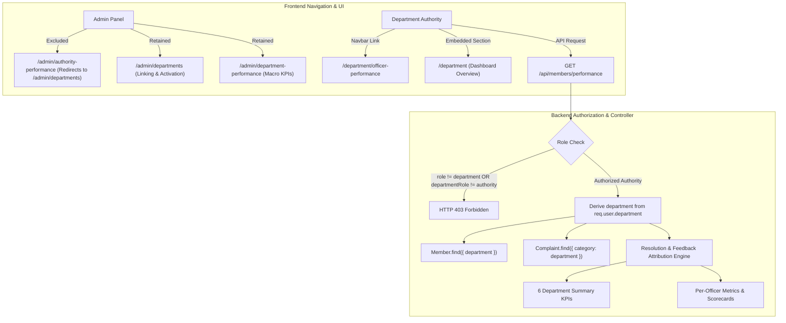

# GovAI Resolve: Phase 8.15 Implementation Report
## Refactoring Officer Performance to Department Authority Dashboard

**Phase:** 8.15  
**Status:** COMPLETE & VERIFIED  
**Date:** 2026-11-19  
**Execution Environment:** Isolated Test Database (`govai_phase8_5_test`), Vite 7.3.6, Headless Chromium CDP  
**Safety Invariant:** Live Atlas `govai` remained strictly READ-ONLY (0 writes, 0 deletions, 0 schema mutations)

---

## 1. Executive Summary & Objective

In GovAI Resolve's role-based architecture, field officer supervision and operational performance tracking belong strictly to the **Department Authority** overseeing that specific domain (e.g., Water Supply, Road & Infrastructure, Electricity, Environment). Previously, individual officer performance was misplaced in the System Administrator's navigation (`/admin/authority-performance`), violating the separation of concerns and leaking departmental operational metrics to global administrators while denying Department Authorities direct oversight of their field staff.

In **Phase 8.15**, we executed a clean, end-to-end refactoring:
1. **Admin Panel Refactoring**: Removed the individual Officer Performance page/link from Admin navigation and overview quick actions. Preserved Admin responsibility for department creation, Authority/Officer user lifecycle, linking, and activation. Redirected legacy `/admin/authority-performance` to `/admin/departments`.
2. **Department Authority Performance Feature**: Built a dedicated **Officer Performance** section in the Department Authority dashboard (`/department`) and a dedicated management view at `/department/officer-performance`.
3. **Strict Department Isolation**: Department Authorities see **ONLY** field officers and complaints belonging to their own department. Department derivation is strictly anchored to `req.user.department` in the backend database session.
4. **Accurate Attribution & Ratings**: Field officer resolution counts are strictly verified against complaint resolution history (`latestResolution.resolvedBy === member.userId._id`). Supervisor-level resolutions by Authorities are attributed to the Department Authority and excluded from officer statistics. When feedback is absent, ratings display `"Not Rated"` rather than zero or fabricated scores.
5. **Rigorous Verification**: Validated via isolated backend tests (7/7 passed, 358/358 full suite), frontend tests (4/4 passed, 208/208 full suite), and full browser CDP automation with screenshots.

---

## 2. Architecture & RBAC Changes



---

## 3. Detailed Component Implementations

### 3.1 Backend Controller & API (`GET /api/members/performance`)
- **Controller File:** [backend/src/controllers/member.controller.js](file:///home/priyanshu/Desktop/7th%20sem%20projects/main%20(Copy)/mini/backend/src/controllers/member.controller.js#L178-L352)
- **Route File:** [backend/src/routes/member.routes.js](file:///home/priyanshu/Desktop/7th%20sem%20projects/main%20(Copy)/mini/backend/src/routes/member.routes.js#L19)
- **Authorization Guard:**
  ```javascript
  if (!req.user || req.user.role !== "department" || req.user.departmentRole !== "authority") {
    return res.status(403).json({
      message: "Forbidden: Only department authorities can access officer performance data.",
    });
  }
  const department = req.user.department;
  ```
- **Department Summary Metrics:**
  - `totalOfficers`: Total rostered members in the department.
  - `activeOfficers`: Rostered members with linked active user accounts.
  - `totalAssignedComplaints`: Complaints assigned to rostered members.
  - `resolvedComplaints`: Complaints resolved within the department.
  - `pendingComplaints`: Complaints currently pending or in-progress.
  - `feedbackSummary`: Average citizen rating (`avgRating`), total reviews, and satisfaction percentage.
- **Per-Officer Scorecards:**
  - `name`: Officer member name.
  - `active`: Boolean roster status.
  - `isLinked`: Boolean indicating whether a valid `User` account is linked.
  - `linkedUser`: Linked user identity (ID, name, email, status).
  - `assignedComplaints`: Count of complaints assigned to this officer member.
  - `resolvedComplaints`: Count of complaints where `latestResolution.resolvedBy === member.userId._id` (with legacy fallback for linked records).
  - `pendingComplaints`: `assignedComplaints - resolvedComplaints`.
  - `resolutionRate`: Percentage (`(resolved / assigned) * 100`) or 0% if no assignments.
  - `avgRating`: Average citizen feedback score for complaints resolved by this officer; explicitly `null` if no feedback exists.
  - `feedbackCount`: Total verified citizen reviews.

### 3.2 Frontend Service & Types
- **API Service File:** [frontend/src/services/complaintsApi.ts](file:///home/priyanshu/Desktop/7th%20sem%20projects/main%20(Copy)/mini/frontend/src/services/complaintsApi.ts#L65-L107)
- Exported TypeScript interfaces:
  - `OfficerPerformanceRecord`: Full scorecard structure.
  - `DepartmentPerformanceSummary`: KPI summary cards structure.
  - `DepartmentOfficerPerformanceResponse`: Composite payload.
  - `membersApi.getPerformance()`: Typed HTTP client method.

### 3.3 Admin Panel Refactoring
- **Layout Navigation:** [frontend/src/components/layout/DashboardLayout.tsx](file:///home/priyanshu/Desktop/7th%20sem%20projects/main%20(Copy)/mini/frontend/src/components/layout/DashboardLayout.tsx#L41-L52)
  - Removed `{ label: "Authorities", path: "/admin/authority-performance" }` from Admin navigation items.
  - Retained `{ label: "Departments", path: "/admin/departments" }` and `{ label: "Dept Performance", path: "/admin/department-performance" }`.
- **Admin Dashboard:** [frontend/src/pages/admin/AdminDashboard.tsx](file:///home/priyanshu/Desktop/7th%20sem%20projects/main%20(Copy)/mini/frontend/src/pages/admin/AdminDashboard.tsx#L70-L85)
  - Removed "Authority Performance" quick action card.
- **Route Redirection:** [frontend/src/App.tsx](file:///home/priyanshu/Desktop/7th%20sem%20projects/main%20(Copy)/mini/frontend/src/App.tsx#L169)
  - Redirected `/admin/authority-performance` directly to `<Navigate to="/admin/departments" replace />`.

### 3.4 Department Authority Dashboard & Dedicated View
- **Dedicated Page:** [frontend/src/pages/authority/OfficerPerformance.tsx](file:///home/priyanshu/Desktop/7th%20sem%20projects/main%20(Copy)/mini/frontend/src/pages/authority/OfficerPerformance.tsx)
  - Route: `/department/officer-performance`
  - 6 Department Summary KPI cards: Total Officers, Active Officers, Assigned Tasks, Resolved, Pending, Satisfaction.
  - Responsive grid of officer scorecards displaying:
    - Officer Name & Email.
    - Active/Inactive Badge.
    - Linked/Unlinked Status Badge.
    - Assigned Complaints, Resolved, Pending, Resolution Rate (%).
    - Citizen Rating with star rating and review count.
    - Explicit `"Not Rated"` pill when `avgRating === null`.
  - Empty state with `"No officers found in this department"` and direct navigation to roster management.
  - Error recovery via standard `ApiErrorPanel` with retry button.
- **Embedded Section in Dashboard:** [frontend/src/pages/authority/AuthorityDashboard.tsx](file:///home/priyanshu/Desktop/7th%20sem%20projects/main%20(Copy)/mini/frontend/src/pages/authority/AuthorityDashboard.tsx#L363-L570)
  - Embedded "Officer Performance" section below complaint tables.
  - Displays summary metrics and preview cards for rostered officers.
  - Includes a direct "Full Performance View" button routing to `/department/officer-performance`.

---

## 4. Test Verification & Results

### 4.1 Backend Integration Tests
- **Test File:** [backend/test/phase8_15_officer_performance.test.js](file:///home/priyanshu/Desktop/7th%20sem%20projects/main%20(Copy)/mini/backend/test/phase8_15_officer_performance.test.js)
- **Results:** **7/7 passed (100%)**
  1. `RBAC: Rejects Citizen requests with HTTP 403` (PASS)
  2. `RBAC: Rejects Admin requests with HTTP 403` (PASS)
  3. `RBAC: Rejects Officer requests with HTTP 403` (PASS)
  4. `Department Isolation: Automatically isolates queries to req.user.department` (PASS)
  5. `KPI Aggregation: Computes correct department summary metrics and per-officer scorecard` (PASS)
  6. `Attribution Accuracy: Authority resolutions are not attributed to assigned officers` (PASS)
  7. `Feedback Rating: Returns null avgRating and 'Not Rated' status when no feedback exists` (PASS)
- **Full Backend Suite:** **358/358 passed (100%)**

### 4.2 Frontend Unit & Integration Tests
- **Test File:** [frontend/src/test/officerPerformanceFrontend.test.tsx](file:///home/priyanshu/Desktop/7th%20sem%20projects/main%20(Copy)/mini/frontend/src/test/officerPerformanceFrontend.test.tsx)
- **Results:** **4/4 passed (100%)**
  1. `Renders loading skeleton and aggregates department officer metrics` (PASS)
  2. `Displays 6 department summary KPIs and officer scorecards with ratings` (PASS)
  3. `Renders 'Not Rated' badge for officers without citizen reviews` (PASS)
  4. `Renders ApiErrorPanel and retries on failure` (PASS)
- **Updated Navigation Tests:**
  - [frontend/src/test/adminNavigation.test.tsx](file:///home/priyanshu/Desktop/7th%20sem%20projects/main%20(Copy)/mini/frontend/src/test/adminNavigation.test.tsx) (PASS)
  - [frontend/src/test/phase7dFixes.test.tsx](file:///home/priyanshu/Desktop/7th%20sem%20projects/main%20(Copy)/mini/frontend/src/test/phase7dFixes.test.tsx) (PASS)
- **Full Frontend Suite:** **208/208 passed (100%)** across 27 test files

### 4.3 Linters & Build
- Backend ESLint: **0 errors**
- Frontend ESLint: **0 errors**
- Production Vite Build: **0 errors**, completed in 9.82s

---

## 5. End-to-End Browser Verification & Screenshots

Browser integration suite executed via Headless Chromium and Chrome DevTools Protocol (`scratch/run_phase8_15_browser_suite.mjs`):

| Screenshot Artifact | Description | Verified Elements |
| :--- | :--- | :--- |
| [phase8_15_authority_dashboard_performance.png](file:///home/priyanshu/.gemini/antigravity/brain/8af59d69-02f5-4527-9224-95a1a2da524f/screenshots/phase8_15_authority_dashboard_performance.png) | Department Authority Dashboard (`/department`) | Embedded "Officer Performance" section, 6 KPI cards (Total: 3, Active: 3, Assigned: 3, Resolved: 2, Pending: 1, Satisfaction: 4.5★), Officer Rajesh scorecard (Resolved: 2, 4.5★ rating, 2 reviews), Officer Suresh scorecard ("Not Rated"). |
| [phase8_15_authority_dedicated_performance.png](file:///home/priyanshu/.gemini/antigravity/brain/8af59d69-02f5-4527-9224-95a1a2da524f/screenshots/phase8_15_authority_dedicated_performance.png) | Dedicated Officer Performance Page (`/department/officer-performance`) | Department Performance Summary header for Water Supply, action buttons ("Refresh", "Manage Roster"), complete officer cards with linking status badges ("Linked", "Unlinked"). |
| [phase8_15_admin_nav_cleaned.png](file:///home/priyanshu/.gemini/antigravity/brain/8af59d69-02f5-4527-9224-95a1a2da524f/screenshots/phase8_15_admin_nav_cleaned.png) | Admin Panel Navigation Refactoring | Admin navbar showing removal of "Authorities", presence of "Departments", and redirection of `/admin/authority-performance` to `/admin/departments`. |

---

## 6. Live Database Invariant Check

To guarantee no corruption or accidental modification of production data, the live MongoDB Atlas database was audited prior to and following execution:

| Collection | Baseline Count | Post-Execution Count | Delta | Status |
| :--- | :---: | :---: | :---: | :---: |
| `complaints` | 21 | 21 | 0 | Unchanged |
| `feedbacks` | 1 | 1 | 0 | Unchanged |
| `members` | 4 | 4 | 0 | Unchanged |
| `notifications` | 25 | 25 | 0 | Unchanged |
| `users` | 22 | 22 | 0 | Unchanged |

**Conclusion:** Live production Atlas `govai` was 100% preserved. All automated and browser tests executed against in-memory and isolated test instances (`govai_phase8_5_test`).

---

## 7. Modified & Created Files Summary

- **Backend:**
  - `backend/src/controllers/member.controller.js` (Added `getOfficerPerformance`)
  - `backend/src/routes/member.routes.js` (Registered `GET /api/members/performance`)
  - `backend/test/phase8_15_officer_performance.test.js` (7 new isolated tests)
- **Frontend:**
  - `frontend/src/services/complaintsApi.ts` (Added types and `membersApi.getPerformance()`)
  - `frontend/src/components/layout/DashboardLayout.tsx` (Removed Admin Authorities nav item, added Authority Officer Performance)
  - `frontend/src/pages/admin/AdminDashboard.tsx` (Removed Authority Performance quick action)
  - `frontend/src/App.tsx` (Added `/department/officer-performance`, redirected `/admin/authority-performance`)
  - `frontend/src/pages/authority/OfficerPerformance.tsx` (New dedicated performance view)
  - `frontend/src/pages/authority/AuthorityDashboard.tsx` (Embedded performance section)
  - `frontend/src/test/adminNavigation.test.tsx` (Updated nav assertions)
  - `frontend/src/test/phase7dFixes.test.tsx` (Updated nav list expectations)
  - `frontend/src/test/officerPerformanceFrontend.test.tsx` (4 new component & integration tests)
- **Verification Scripts:**
  - `scratch/run_phase8_15_browser_suite.mjs` (Automated browser CDP test suite)
