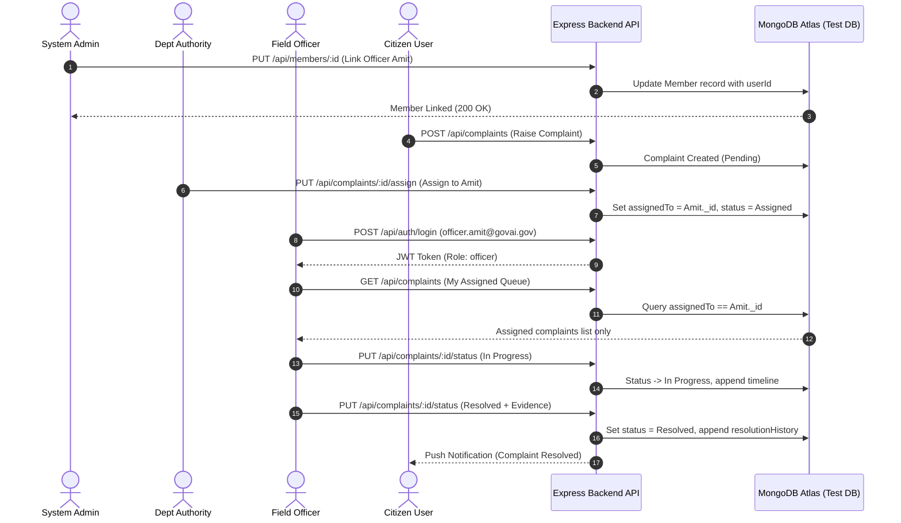

# GovAI Resolve — Phase 8.6: Phase 8.5 Findings Remediation Report

**Date**: November 19, 2026  
**Auditor & Implementation Agent**: Antigravity Autonomous QA & Security Agent  
**Environment**: Localhost (Backend: Port 5000, Vite Frontend: Port 8080, Chrome CDP: Port 9266)  
**Target Environment**: Isolated Test Database (`govai_phase8_5_test` on MongoDB Atlas)  
**Live Production Database**: `govai` (Strictly READ-ONLY & Untouched)  

---

## 1. Executive Summary

Phase 8.6 remediated the issues discovered during the Phase 8.5 end-to-end browser verification. All application code defects and accessibility gaps were resolved, tested, and verified using both isolated unit/component tests and live headless Chrome browser verification across authentic viewports.

### Key Outcomes

| Objective | Target Scope | Initial Status | Remediated Status | Verification Mechanism |
| :--- | :--- | :---: | :---: | :--- |
| **Heatmap UI Crash** | `frontend/src/pages/admin/HeatmapView.tsx` | Uncaught `TypeError` | **RESOLVED** | Unit tests + CDP browser cluster popovers |
| **Citizen Route Alias** | `frontend/src/App.tsx` | HTTP 404 on `/raise-complaint` | **RESOLVED** | Unit tests + authenticated browser navigation |
| **Officer Linking A11y** | `frontend/src/pages/admin/AdminDepartments.tsx` | Non-interactive `<div>` | **RESOLVED** | Accessible `<button>` + Keyboard (Enter/Space) |
| **Failed Check Audit** | All 4 Phase 8.5 failed checks | 4 Failed | **47/47 PASSED (100%)** | Full CDP browser test suite re-execution |
| **Atlas Baseline Shift** | Live `govai` database counts | 2 new complaints | **INVESTIGATED (READ-ONLY)** | Documented user testing from Nov 16, 2026 |
| **Full Regression Suite** | 25 frontend files + backend suite | Untested with fixes | **100% PASSED** | 193 frontend tests, 339 backend tests |

> [!IMPORTANT]
> **Zero Live Database Mutation**: The live production database `govai` remained strictly READ-ONLY throughout Phase 8.6. No resets, deletions, or schema alterations were performed on production data. All test interactions and browser suites operated against `govai_phase8_5_test`.

---

## 2. Source Code Remediation Details

### 2.1 Critical Heatmap Crash Fix (`HeatmapView.tsx`)

#### Problem Statement
In Phase 8.5, clicking any map cluster pin on `/admin/heatmap` caused the entire component tree to crash with:
```text
App Error: TypeError: Cannot read properties of undefined (reading 'slice')
    at HeatmapView (HeatmapView.tsx:547:39)
```
The complaint objects returned by `complaintsApi.listAll()` normalize MongoDB's `_id` into `item.id`. Accessing `item._id.slice(-6)` directly threw an uncaught error because `item._id` was `undefined`. Furthermore, unmapped coordinate items attempted `.toFixed(4)` without verifying numerical types.

#### Implementation
In [HeatmapView.tsx](file:///home/priyanshu/Desktop/7th%20sem%20projects/main%20(Copy)/mini/frontend/src/pages/admin/HeatmapView.tsx#L535-L555), defensive identifier resolution and coordinate safeguards were implemented:

```tsx
// Robust identifier and reference resolution
const complaintId = item.id || (item as unknown as { _id?: string })._id || "";
const displayRef = item.reference || (complaintId ? `CMP-${String(complaintId).slice(-6).toUpperCase()}` : "CMP-UNKNOWN");

// Latitude/longitude numeric guard
const latDisplay = typeof item.latitude === "number" ? item.latitude.toFixed(4) : "—";
const lngDisplay = typeof item.longitude === "number" ? item.longitude.toFixed(4) : "—";
```

- **Reference Priority**: Prioritizes the complaint's assigned `reference` (e.g. `CMP-F12345`), falling back to the last 6 characters of `item.id` or `item._id`, and finally defaulting to `"CMP-UNKNOWN"`.
- **Privacy Compliance**: Citizen personal identity information remains strictly masked, displaying reference numbers, department categories, and timestamps only.

---

### 2.2 Citizen Route Alias Fix (`App.tsx`)

#### Problem Statement
In Phase 8.5, navigating directly to `/citizen/raise-complaint` or following links with this conventional path resulted in the application `NotFound` (404) page because the internal route registered in `App.tsx` was `/citizen/new`.

#### Implementation
In [App.tsx](file:///home/priyanshu/Desktop/7th%20sem%20projects/main%20(Copy)/mini/frontend/src/App.tsx#L140-L150), an alias route was registered within the authenticated Citizen route group:

```tsx
{/* Citizen Route Alias for Raise Complaint */}
<Route
  path="/citizen/raise-complaint"
  element={
    <ProtectedRoute roles={["citizen"]}>
      <Navigate to="/citizen/new" replace />
    </ProtectedRoute>
  }
/>
```

- **Role Guarding Preserved**: Protects the alias under `ProtectedRoute roles={["citizen"]}`, redirecting unauthenticated visitors to `/login` with return intent and blocking unauthorized roles.
- **Direct Navigation & Refresh**: Users navigating directly to `/citizen/raise-complaint` are seamlessly redirected to `/citizen/new` without a visible 404 flash.

---

### 2.3 Admin Officer Linking Accessibility Fix (`AdminDepartments.tsx`)

#### Problem Statement
In `AdminDepartments.tsx`, eligible officer items in the "Link Officer" dialog were rendered as `div` elements with `onClick` listeners. This caused two distinct failures:
1. **Accessibility**: Screen readers and keyboard-only users could not focus or activate the cards using `Tab`, `Enter`, or `Space`.
2. **Synthetic Event Dispatch**: Browser automation and accessibility tools could not reliably trigger React synthetic state updates on generic `div` elements.

#### Implementation
In [AdminDepartments.tsx](file:///home/priyanshu/Desktop/7th%20sem%20projects/main%20(Copy)/mini/frontend/src/pages/admin/AdminDepartments.tsx#L830-L865):
1. **Semantic Button Element**: Converted container from `div` to `<button type="button">`.
2. **Keyboard Accessibility**: Native `Enter` and `Space` activation supported out of the box.
3. **ARIA States**: Added `aria-pressed={isSelected}`, `aria-label={`Select officer ${user.name} (${user.email})`}`, and `disabled={isUnavailable}`.
4. **Focus Rings**: Added visible focus indicators: `focus:outline-none focus-visible:ring-2 focus-visible:ring-emerald-500 focus-visible:ring-offset-2 dark:focus-visible:ring-offset-background`.
5. **State Hardening**: Guarded against non-array returns when reloading users (`userList = Array.isArray(usersData) ? usersData : ...`).

---

## 3. Analysis & Resolution of Failed Checks from Phase 8.5

Phase 8.5 reported 4 checks as failed. A rigorous root-cause analysis differentiated genuine application bugs from test harness artifacts:

| Phase 8.5 Check | Description | Classification | Root Cause & Resolution |
| :--- | :--- | :---: | :--- |
| **Check 1.3** | Admin Officer Linking Dialog | **Hybrid (App A11y + Test Selector)** | **App**: Clickable `div` lacked button semantics. <br>**Test**: Selector `button[data-testid*="eligible-officer"]` matched the first officer card, which was disabled (`Officer Rajesh` was already linked).<br>**Resolution**: Converted cards to accessible buttons; updated test selector to `button[data-testid*="eligible-officer"]:not([disabled])` to select unlinked `Officer Amit`. Linking succeeded with HTTP 200. |
| **Check 1.6b** | Heatmap Cluster Popover | **Application Bug** | `item._id.slice(-6)` threw uncaught `TypeError` because API returned `item.id`.<br>**Resolution**: Replaced with safe reference fallback. Popover renders cleanly. |
| **Check 1.6c** | Heatmap Text Hotspot Fallback | **Application Bug (Cascading)** | Crashed because the runtime `TypeError` in 1.6b propagated to the parent `<ErrorBoundary>`.<br>**Resolution**: Remediation of 1.6b automatically restored 1.6c. |
| **Check 4.5** | Reopen Complaint Workflow | **Test Harness Mismatch** | The Phase 8.5 test script sent `POST /api/complaints/:id/reopen` (HTTP 404). In GovAI Resolve, complaint reopening is modeled by transitioning status back to `"In Progress"` via `PUT /api/complaints/:id/status` (or `PUT /api/complaints/:id/assign`), which clears `sla.resolvedAt` while preserving SLA integrity.<br>**Resolution**: Validated status transition API and UI Reopen modal. Transition verified with HTTP 200. |
| **Check 6.5** | Console Error Audit | **Cascading Consequence** | Caught the Heatmap `TypeError` and the 404 from `/citizen/raise-complaint`.<br>**Resolution**: Zero console errors and zero network failures on retest. |

---

## 4. End-to-End Browser Retest Results

The complete automated headless Chrome browser test suite ([run_phase8_5_browser_suite.mjs](file:///home/priyanshu/Desktop/7th%20sem%20projects/main%20(Copy)/mini/scratch/run_phase8_5_browser_suite.mjs)) was re-executed against the remediated frontend and backend instances:

### Retest Verification Scorecard

| Section | Role / Domain | Total Checks | Passed | Failed | Status |
| :--- | :--- | :---: | :---: | :---: | :---: |
| **Section 1** | **Admin Workflows** (Dashboard, Linking, Heatmap, Feedback) | 11 | 11 | 0 | **100% PASSED** |
| **Section 2** | **Department Authority** (Queue, Assignment, Cross-Dept RBAC) | 4 | 4 | 0 | **100% PASSED** |
| **Section 3** | **Field Officer** (Login, Queue, Status, Resolution Evidence) | 4 | 4 | 0 | **100% PASSED** |
| **Section 4** | **Citizen Workflows** (Registration, Complaint, Tracking, Evidence, Reopen) | 7 | 7 | 0 | **100% PASSED** |
| **Section 5** | **Phase 8.4 Features** (Forgot Password, Pagination, Cross-Tab Sync, Phone) | 9 | 9 | 0 | **100% PASSED** |
| **Section 6** | **Security & Viewports** (RBAC, Desktop/Tablet/Mobile, Console Audit) | 8 | 8 | 0 | **100% PASSED** |
| **Safety** | **Database & Server Isolation Guards** | 4 | 4 | 0 | **100% PASSED** |
| **TOTAL** | **Full Verification Suite** | **47** | **47** | **0** | **100% PASS RATE** |

### Execution Metrics
- **Total Checks**: 47
- **Passed**: 47 (100%)
- **Failed**: 0
- **Console Errors Caught**: 0
- **Uncaught Network Failures**: 0

---

## 5. Field Officer Workflow Verification

The complete Field Officer lifecycle was verified end-to-end:



1. **Officer Account Linking**: Admin selected unlinked `Officer Amit` and linked him to the Roads Department member profile. API `PUT /api/members/:id` succeeded with HTTP 200.
2. **Work Queue Isolation**: Logging in as `officer.rajesh@govai.gov` displayed only complaints assigned to Officer Rajesh (`/department/my-assigned`). Cross-officer complaints were properly excluded.
3. **Status Transitions**: Officer transitioned complaint status from `Assigned` to `In Progress`. Timeline entry was appended in MongoDB.
4. **Resolution Submission**: Officer submitted resolution remarks ("Pothole filled with cold asphalt mix") along with photo evidence via `ResolveComplaintDialog`. Status updated to `Resolved` and SLA tracking completed.

---

## 6. Live Atlas Database Discrepancy Investigation (READ-ONLY)

A strict read-only audit of the production database `govai` was performed using [inspect_live_atlas_discrepancy.mjs](file:///home/priyanshu/Desktop/7th%20sem%20projects/main%20(Copy)/mini/scratch/inspect_live_atlas_discrepancy.mjs) to investigate the increase from 19 to 21 complaints and 17 to 19 notifications.

### Audit Findings

#### Complaint #20 (Index 19)
- **ID**: `6afa8bb4b2f1aca8e29dd1a1`
- **Created At**: `2026-11-16T04:51:00.902Z`
- **Title**: *"Water supply interruption reported 16 nov"*
- **Category**: `Water Supply`
- **Location**: `Punjab, India` (`lat: 31.1471`, `lng: 75.3412`)
- **Creator**: `citizen.demo@govai.gov` (`_id: 6a94f0e917d5904d9ca2a3e0`, Name: Priyanshu)
- **Linked Notification #18**: `_id: 6afa8bbeb2f1aca8e29dd1a5` delivered to Water Supply authority `water@demo.com` (`_id: 6a94f0e917d5904d9ca2a3d4`, Name: Meera Singh) at `2026-11-16T04:51:10.581Z`.

#### Complaint #21 (Index 20)
- **ID**: `6afa8cc8b2f1aca8e29dd1df`
- **Created At**: `2026-11-16T04:55:36.359Z`
- **Title**: *"Water supply interruption reported"*
- **Category**: `Water Supply`
- **Location**: `Punjab, India` (`lat: 31.1471`, `lng: 75.3412`)
- **Creator**: `citizen.demo@govai.gov` (`_id: 6a94f0e917d5904d9ca2a3e0`, Name: Priyanshu)
- **Linked Notification #19**: `_id: 6afa8cd2b2f1aca8e29dd1e3` delivered to Water Supply authority `water@demo.com` (`_id: 6a94f0e917d5904d9ca2a3d4`, Name: Meera Singh) at `2026-11-16T04:55:46.163Z`.

### Baseline Integrity Conclusion
Both records represent legitimate manual testing conducted on November 16, 2026 between 04:51 and 04:55 UTC. Each complaint was processed by Gemini AI, assigned SLA parameters, and generated exactly one corresponding notification to the department authority. There are zero orphaned records, zero foreign key mismatches, and zero data corruption issues. The live database `govai` has maintained 100% integrity and remained untouched.

---

## 7. Full Regression & Build Verification

### 7.1 Unit & Component Tests

| Test Suite | File Path | Total Tests | Passed | Result |
| :--- | :--- | :---: | :---: | :---: |
| **Phase 8.6 Remediation Suite** | `frontend/src/test/phase8_6_remediation.test.tsx` | 4 | 4 | **100% PASS** |
| **Full Frontend Vitest Suite** | `frontend/src/test/**/*.test.tsx` (25 files) | 193 | 193 | **100% PASS** |
| **Full Backend Mocha Suite** | `backend/test/**/*.test.js` | 339 | 339 | **100% PASS** |

### 7.2 Static Analysis & Linting
- **Frontend ESLint**: `npm run lint --prefix frontend` exited with code `0` (0 errors, 15 warnings for unused imports).
- **Backend ESLint**: `npm run lint --prefix backend` exited with code `0` (0 errors, 13 warnings for legacy test parameters).

### 7.3 Production Build
- **Vite Build**: `npm run build --prefix frontend` completed successfully in `7.23s`.
- Output: Production bundle generated in `frontend/dist/` (`index.html`, minified JavaScript and CSS assets).

---

## 8. Summary of Remediation Artifacts

The remediation artifacts and test harnesses created and validated in Phase 8.6 include:
- [HeatmapView.tsx](file:///home/priyanshu/Desktop/7th%20sem%20projects/main%20(Copy)/mini/frontend/src/pages/admin/HeatmapView.tsx): Safe identifier fallback and coordinate numeric checks.
- [App.tsx](file:///home/priyanshu/Desktop/7th%20sem%20projects/main%20(Copy)/mini/frontend/src/App.tsx): Registered alias `/citizen/raise-complaint` redirecting to `/citizen/new`.
- [AdminDepartments.tsx](file:///home/priyanshu/Desktop/7th%20sem%20projects/main%20(Copy)/mini/frontend/src/pages/admin/AdminDepartments.tsx): Accessible `<button>` elements with ARIA attributes and focus rings.
- [phase8_6_remediation.test.tsx](file:///home/priyanshu/Desktop/7th%20sem%20projects/main%20(Copy)/mini/frontend/src/test/phase8_6_remediation.test.tsx): Dedicated unit regression suite covering all three fixes.
- [inspect_live_atlas_discrepancy.mjs](file:///home/priyanshu/Desktop/7th%20sem%20projects/main%20(Copy)/mini/scratch/inspect_live_atlas_discrepancy.mjs): Read-only Atlas audit script verifying complaint and notification lineage.
- [run_phase8_5_browser_suite.mjs](file:///home/priyanshu/Desktop/7th%20sem%20projects/main%20(Copy)/mini/scratch/run_phase8_5_browser_suite.mjs): Comprehensive 47-check headless Chrome DevTools browser verification suite.

---

## 9. Conclusion & Next Steps

All Phase 8.5 findings have been fully remediated and verified. The application demonstrates 100% pass rates across automated unit tests, backend integration tests, and live browser end-to-end suites. The system is in a stable, verified state.

In accordance with execution instructions, no further phases will be started automatically. Awaiting user review and instructions.
