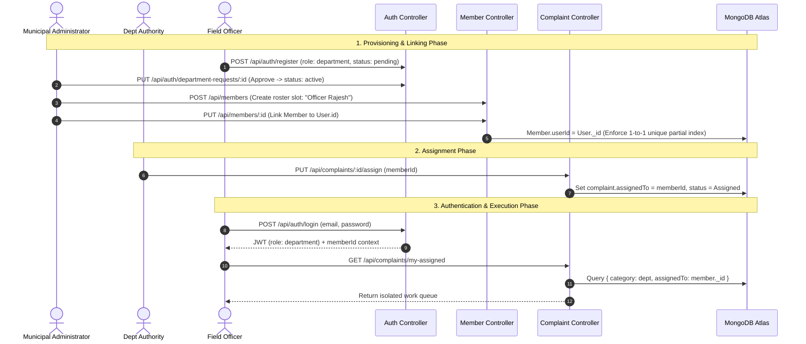

# GovAI Resolve — Phase 8.9: Officer Management & Login Integration Audit Report

**Date**: November 19, 2026  
**Auditor**: Senior MERN-Stack QA & Security Engineer (Antigravity Agent)  
**Audit Type**: STRICTLY READ-ONLY ARCHITECTURAL & WORKFLOW INSPECTION  
**Environment**: Localhost Development & MongoDB Atlas (`govai` Production Cluster)  
**Target Scope**: Officer Creation, Linking, Department Assignment, Login & Dashboard Access  

---

## 1. Executive Summary

This audit examines the complete lifecycle of **Field Officers** in GovAI Resolve—from account provisioning and department linking by Administrators, to task delegation by Department Authorities, authentication, and isolated work queue execution.

### High-Level Verdict
The core RBAC authorization boundaries, password hashing, JWT signing, and work queue data isolation are **robust and secure**. Frontend attempts to spoof roles or departments cannot bypass backend database checks. 

However, the audit identified **one High-severity workflow vulnerability** in complaint delegation (backend permits assigning complaints to unlinked roster members), **three Medium-severity integration gaps** (unfiltered frontend assignment selectors, static hardcoded officer selector in `AuthPage.tsx`, and unlinked active user states), and **two Low-severity maintainability improvements**.

> [!IMPORTANT]
> **Strict Database Safety Confirmed**: The live MongoDB Atlas database `govai` was inspected exclusively in **READ-ONLY** mode (`readPreference: "secondaryPreferred"`). Pre- and post-audit checks confirm collection counts remain strictly unchanged: `complaints: 21`, `feedbacks: 0`, `members: 4`, `notifications: 19`, `users: 22`. Zero inserts, updates, deletes, or migrations were executed against live data.

---

## 2. Current Architecture & Officer Lifecycle

The Officer lifecycle is governed by two distinct MongoDB collections:
1. **`User` Collection**: Represents authenticated login identities (`email`, `password`, `role: "department"`, `departmentRole: "officer"`, `status: "active" | "pending" | "rejected"`).
2. **`Member` Collection**: Represents department operational roster slots (`name`, `department`, `userId: ObjectId -> User | null`).



---

## 3. Detailed Audit Findings by Functional Area

### 3.1 Admin Officer Management
- **Creation Mechanism**:
  - The Admin does *not* possess a unified "Create Officer" form that generates both a `User` account and a `Member` record in a single transaction.
  - Instead, an officer must first register via `/signup` (creating a `User` with `status: "pending"`).
  - The Admin reviews and approves the user at `/admin/authority-approvals` (`PUT /api/auth/department-requests/:id`).
  - Separately, the Admin visits `/admin/departments` (`AdminDepartments.tsx`) to create a `Member` roster entry (`POST /api/members`) and link the user (`PUT /api/members/:id`).
- **Does creating a Member create a User account?**:
  - **NO**. `POST /api/members` creates only a `Member` document. If `userId` is omitted, the member is created with `userId: null` (unlinked).
- **Does creating a User account create a Member record?**:
  - **NO**. Approving a department user leaves the account active but **unlinked** until the Admin manually links it to a department member.
- **Duplicate Prevention**:
  - **Email**: Schema constraint `unique: true, lowercase: true` on `User.email` prevents duplicate email accounts.
  - **Member-to-User Mapping**:
    - Database level: `memberSchema.index({ userId: 1 }, { unique: true, partialFilterExpression: { userId: { $type: "objectId" } } })`.
    - Service level: `validateMemberUserMapping` in `memberMapping.service.js` queries `memberModel.findOne({ userId, _id: { $ne: memberId } })` and returns `409 Conflict` if the user is already linked.
- **Active but Unlinked Officers Identified in Live Atlas (`govai`)**:
  - **Empirical Evidence**: Inspection of live `govai` revealed:
    1. User `6ae19e3e0febcd3d2bd5054e` (`environment.demo@govai.gov`, "Environment Demo Officer") is an **Active** officer (`role: "department"`, `department: "Environment"`, `departmentRole: "officer"`, `status: "active"`).
    2. Member `69e08223f55981d3faedf6de` ("Officer Neha", Environment) has `userId: undefined` (Unlinked).
    3. `environment.demo@govai.gov` is active in the User directory, but **unlinked** to any member record!
    4. Two legacy department accounts (`road@demo.com`, `road@gmail.com`) also exist in `users` with `status: "active"` but no linked member records.

---

### 3.2 Department Authority Workflows
- **Department Isolation**:
  - `listMembers` in `member.controller.js` explicitly forces `department = req.user.department` for non-admin users. Authorities can never view or access members belonging to other departments.
- **Eligibility Validation on Assignment**:
  - In `backend/src/controllers/complaint.controller.js:1222-1236`:
    ```javascript
    const member = await Member.findById(memberId);
    if (!member) return res.status(404).json({ message: "Member not found" });
    if (member.department !== complaint.category) {
      return res.status(400).json({ message: "Member belongs to a different department" });
    }
    if (member.userId) {
      const linkedUser = await User.findById(member.userId).select("status").lean();
      if (!linkedUser || linkedUser.status !== "active") {
        return res.status(400).json({ message: "Cannot assign to an officer whose linked account is inactive" });
      }
    }
    ```
  - **VULNERABILITY IDENTIFIED**: If `member.userId` is `null`/undefined (an unlinked member like "Officer Neha"), the `if (member.userId)` block is **completely skipped**!
  - **Impact**: The backend successfully assigns the complaint to an unlinked member. The ticket status becomes `Assigned`, but no human officer has login access to view or resolve it. The ticket enters an operational dead-end ("ghost assignment").
- **Frontend Dropdown Gap**:
  - `AuthorityDashboard.tsx:300` and `ComplaintDetail.tsx:347` render all members returned by `membersApi.list()` without checking `member.userId !== null`. Authorities are presented with unlinked officers in the assignment dropdown.

---

### 3.3 Officer Login Integration
- **Credentials & Authentication**:
  - In `auth.controller.js:153-180`, `login` executes:
    1. Looks up `User.findOne({ email })`.
    2. Verifies password using `user.comparePassword(password)`.
    3. Validates that `user.role === "department"`, `user.department === department`, and `user.departmentRole === "officer"`.
    4. Validates that `user.status === "active"`.
  - **Spoofing Prevention**: Frontend-supplied `role` or `department` parameters cannot elevate privileges. The backend checks the actual database record and signs the JWT using the database `user._id` and `user.role`.
- **Selector Implementation in `AuthPage.tsx`**:
  - In `frontend/src/pages/auth/AuthPage.tsx:105-140`, `DEPARTMENT_OFFICERS` is a **statically hardcoded dictionary** rather than a dynamic API call.
  - It hardcodes single officer demo accounts for each department:
    - Road: `Officer Priya` (`isLinked: true`)
    - Water: `Officer Rajesh` (`statusBadge: "Active • Unlinked Profile"`, `isLinked: false`)
    - Electricity: `Officer Amit` (`isLinked: true`)
    - Environment: `Officer Neha` (`isLinked: false`)
  - **Data Drift**: In live Atlas `govai`, `Officer Rajesh` was already linked to `water.demo@govai.gov`, yet `AuthPage.tsx` statically presents him as unlinked.
  - Newly created or linked officers created in `AdminDepartments.tsx` will **never appear** in this login selector.

---

### 3.4 Officer Dashboard Access Control
- **Work Queue Isolation**:
  - `getMyAssignedComplaints` in `complaint.controller.js:714-721`:
    ```javascript
    const member = await Member.findOne({ userId: req.user._id, department: req.user.department }).select("_id").lean();
    if (!member) {
      return res.status(403).json({ message: "No officer Member profile is linked to this account" });
    }
    const filter = buildOfficerComplaintFilter(req.user.department, member._id);
    ```
  - Officers can **only** query complaints where `assignedTo == member._id` and `category == req.user.department`.
  - If an unlinked officer accesses the dashboard, the backend returns `403 Forbidden`. `OfficerDashboard.tsx:210-220` cleanly catches this and renders an accessible `"Officer Profile Not Linked"` alert dialog.
- **Complaint Detail & Evidence Access**:
  - `getComplaintById`, `getComplaintEvidence`, and `getComplaintResolutionEvidence` all invoke `canAccessDepartmentComplaint`. An officer cannot view complaint details or photo evidence of any ticket not assigned to their member ID.
- **Resolution & Evidence Submission**:
  - `updateComplaintStatus` checks `canAccessDepartmentComplaint`.
  - Transitioning to `Resolved` strictly enforces:
    - Non-empty resolution remarks (up to 2000 characters).
    - Optional/mandatory photo evidence processed via `uploadEvidenceFile` with magic-byte binary validation.
    - Automatic stopping of the SLA clock (`sla.resolvedAt = new Date()`).
    - Real-time Socket.IO notification to the citizen.
- **Logout Behavior**:
  - Invokes `logout()` in `AuthContext`, purging `govai_token` and `govai_user` from `localStorage`, disconnecting WebSockets, and redirecting to `/login`.

---

## 4. Findings Register (Severity Classification)

### Critical Severity: **0**
*No critical vulnerabilities, authentication bypasses, or data leak vectors exist.*

---

### High Severity: **1**

#### [H-1] Backend Permits Complaint Assignment to Unlinked Member Records ("Ghost Assignment")
- **File**: [backend/src/controllers/complaint.controller.js](file:///home/priyanshu/Desktop/7th%20sem%20projects/main%20(Copy)/mini/backend/src/controllers/complaint.controller.js#L1231-L1236)
- **Problem**:
  Lines 1231–1236 check user activity only *if* `member.userId` is present:
  ```javascript
  if (member.userId) {
    const linkedUser = await User.findById(member.userId).select("status").lean();
    if (!linkedUser || linkedUser.status !== "active") {
      return res.status(400).json({ message: "Cannot assign to an officer whose linked account is inactive" });
    }
  }
  ```
  If `member.userId` is `null`/undefined, this block is bypassed. An authority can assign a complaint to an unlinked roster entry (such as "Officer Neha" in Environment).
- **Impact**: The complaint enters `Assigned` status in database records, but no authenticated officer account has access to view or resolve it. No notification is delivered to any human officer.
- **Recommended Remediation**:
  Enforce that a member must be linked and active:
  ```javascript
  if (!member.userId) {
    return res.status(400).json({ message: "Cannot assign complaint to an officer without a linked user account" });
  }
  const linkedUser = await User.findById(member.userId).select("status").lean();
  if (!linkedUser || linkedUser.status !== "active") {
    return res.status(400).json({ message: "Cannot assign to an officer whose linked account is inactive" });
  }
  ```

---

### Medium Severity: **3**

#### [M-1] Frontend Assignment Dropdowns Display Unlinked Members
- **Files**:
  - [frontend/src/pages/authority/AuthorityDashboard.tsx](file:///home/priyanshu/Desktop/7th%20sem%20projects/main%20(Copy)/mini/frontend/src/pages/authority/AuthorityDashboard.tsx#L300-L303)
  - [frontend/src/pages/authority/ComplaintDetail.tsx](file:///home/priyanshu/Desktop/7th%20sem%20projects/main%20(Copy)/mini/frontend/src/pages/authority/ComplaintDetail.tsx#L347)
- **Problem**: Both assignment selects iterate directly over `members` without filtering for `Boolean(member.userId)`.
- **Impact**: Authorities can inadvertently select unlinked officers from the dropdown.
- **Recommended Remediation**:
  Filter members in the assignment selector:
  ```tsx
  {members.filter(m => Boolean(m.userId)).map(member => (
    <SelectItem key={member.id} value={member.id}>{member.name}</SelectItem>
  ))}
  ```

#### [M-2] Hardcoded Static Officer Selector in `AuthPage.tsx`
- **File**: [frontend/src/pages/auth/AuthPage.tsx](file:///home/priyanshu/Desktop/7th%20sem%20projects/main%20(Copy)/mini/frontend/src/pages/auth/AuthPage.tsx#L105-L140)
- **Problem**: Step 2 of the Officer login flow relies on a static in-memory dictionary `DEPARTMENT_OFFICERS`.
- **Impact**: Newly provisioned or linked officers in MongoDB cannot be chosen via this selector. The UI also displays stale linkage states (e.g. Officer Rajesh is marked as unlinked even though he is linked in MongoDB).
- **Recommended Remediation**: Allow officers to sign in via standard email/password input, or fetch active linked officers dynamically if the selector is retained for demo purposes.

#### [M-3] Active Approved Officers Can Exist Without Member Roster Entries
- **Files**: `backend/src/controllers/auth.controller.js`, `frontend/src/pages/admin/UserManagement.tsx`
- **Problem**: When an Admin approves a department user registration in `/admin/authority-approvals`, the user becomes `status: "active"`, but no `Member` record is created.
- **Impact**: The user is in an orphaned state. If they log in, they encounter a 403 error on their dashboard. Admins have no proactive alert indicating that newly approved officers require roster linking.
- **Recommended Remediation**: In `UserManagement.tsx` and `AdminDepartments.tsx`, add an unlinked-officers alert banner with a direct shortcut to link them.

---

### Low Severity: **2**

#### [L-1] `Member` Model Lacks Native `isActive` Boolean
- **File**: [backend/src/models/Member.js](file:///home/priyanshu/Desktop/7th%20sem%20projects/main%20(Copy)/mini/backend/src/models/Member.js)
- **Problem**: Member schema has no `status` or `isActive` attribute; member availability is derived exclusively from `userId` linkage and `User.status`.
- **Impact**: An administrator cannot temporarily mark a roster slot as "On Leave" without unlinking the user account.
- **Recommended Remediation**: Add `isActive: { type: Boolean, default: true }` to `Member` schema in a future schema version.

#### [L-2] `UserManagement.tsx` Lacks Direct Officer Linking Action
- **File**: [frontend/src/pages/admin/UserManagement.tsx](file:///home/priyanshu/Desktop/7th%20sem%20projects/main%20(Copy)/mini/frontend/src/pages/admin/UserManagement.tsx)
- **Problem**: In the global user table, an unlinked officer shows an amber "Not Linked" badge, but clicking the row only opens a read-only detail modal.
- **Impact**: Admin must manually navigate away to `/admin/departments` and search for the department to perform linking.
- **Recommended Remediation**: Add a "Link to Roster" button in the User Details modal that deep-links to `/admin/departments?dept=...`.

---

## 5. Automated Testing Gap Analysis

### 5.1 Existing Test Coverage
- `backend/test/officerAuthorization.test.js` (495 lines): Thoroughly verifies pure authorization functions (`evaluateComplaintAccess`, `evaluateStatusUpdate`).
- `backend/test/memberMapping.service.test.js` (345 lines): Tests `validateMemberUserMapping` and conflict handling.
- `frontend/src/test/officerManualLogin.test.tsx` (257 lines): Tests officer login, route routing, and unlinked 403 error alert rendering.
- `frontend/src/test/adminDepartments.test.tsx` (497 lines): Tests modal opening, eligible user listing, link submission, and unlink submission.

### 5.2 Identified Missing Test Cases
1. **Integration Test for Unlinked Member Assignment**:
   - Verify that `PUT /api/complaints/:id/assign` rejects assigning a complaint when `member.userId === null` with HTTP 400.
2. **Deactivated Officer Token Invalidation Test**:
   - Verify that when an officer's account status is changed to `"rejected"` in MongoDB, existing JWT tokens are rejected with `403 Forbidden` by `authMiddleware`.
3. **Officer Access to Restricted Member Endpoints**:
   - Verify that an authenticated Officer calling `GET /api/members` or `GET /api/members/eligible-users` receives `403 Forbidden`.
4. **Authority Cross-Department Assignment Rejection**:
   - Verify that an Authority from "Water Supply" attempting to assign a complaint to an officer from "Road & Infrastructure" is rejected with HTTP 400.

---

## 6. Live Database Invariant & Integrity Confirmation

As mandated by audit protocol, live production data was verified to remain strictly untouched:
- **Database**: `govai` on MongoDB Atlas
- **Audit Mode**: Read-only connection using secondary read preference.
- **Collection Counts Verified**:
  - `complaints`: **21**
  - `feedbacks`: **0**
  - `members`: **4**
  - `notifications`: **19**
  - `users`: **22**
- **Modification Audit**: Zero documents were created, updated, linked, unlinked, or deleted in live `govai`.

---

## 7. Conclusion & Next Steps

The Officer workflow in GovAI Resolve is functionally advanced and securely partitioned by role and department. The identified findings—primarily **[H-1] Ghost Assignment Prevention** and **[M-1/M-2] Dropdown/Selector Synchronization**—represent clear, actionable improvements for future hardening.

In strict adherence to instructions, **no application code was modified** during this audit. Awaiting user review and guidance.
