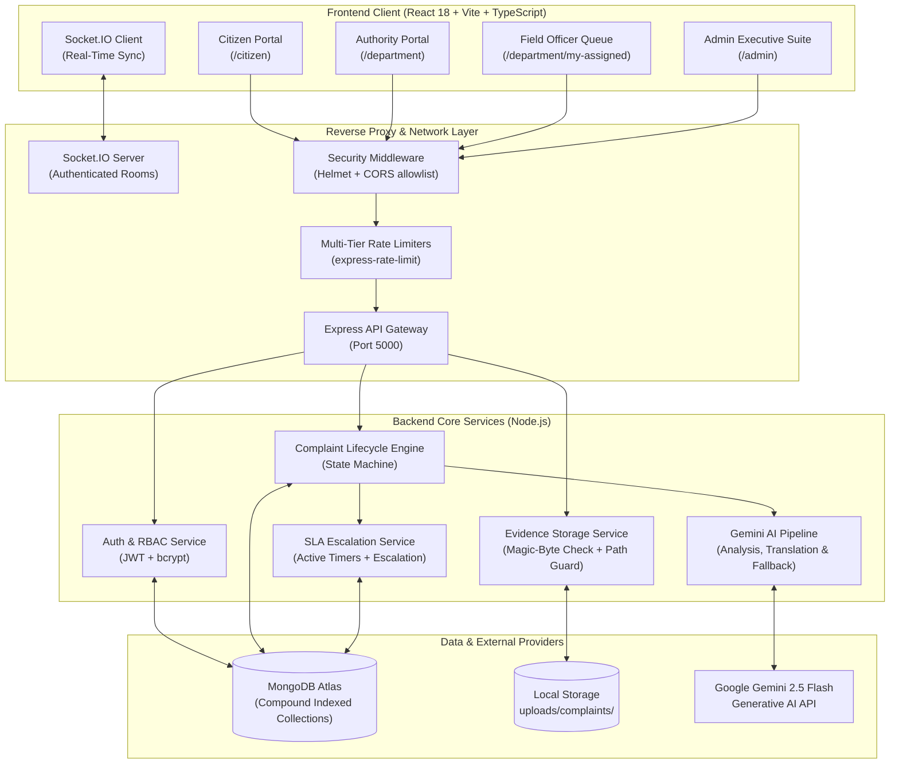

# GovAI Resolve: AI-Powered Civic Complaint Governance Platform

[](https://nodejs.org/)
[](https://reactjs.org/)
[](https://www.typescriptlang.org/)
[](https://vitejs.dev/)
[](https://www.mongodb.com/)
[](https://tailwindcss.com/)
[](https://ai.google.dev/)
[](LICENSE)

GovAI Resolve is a full-stack, enterprise-grade civic grievance redressal and complaint governance system developed as a final-year B.Tech engineering capstone project. The platform integrates modern web technologies, multi-role Role-Based Access Control (RBAC), real-time bidirectional WebSocket communication, and Google Gemini 2.5 Flash Generative AI to automate civic complaint classification, urgency-based Service Level Agreement (SLA) enforcement, and end-to-end evidence-based resolution tracking.

---

## 1. Executive Overview & Problem Statement

### 1.1 The Civic Challenge
Traditional municipal grievance redressal systems suffer from systemic operational bottlenecks:
- **Manual Routing Delays**: Citizens submit complaints to generalized portals, requiring manual human sorting that introduces multi-day triage delays.
- **Arbitrary Priority Assignment**: Critical infrastructure hazards (e.g. contaminated drinking water, live electrical wires) sit in queues with identical priority to non-urgent cosmetic requests.
- **Language Barriers**: Citizens describing civic problems in regional languages (e.g. Hindi, Punjabi) face delays due to lack of municipal translators.
- **Accountability Voids**: Complaints lack verifiable resolution proof, leading to disputed statuses and citizen distrust.
- **Opaque SLA Tracking**: Municipal authorities lack real-time visibility into backlog growth, officer workloads, and overdue deadlines.

### 1.2 The GovAI Resolve Solution
GovAI Resolve re-architects civic complaint governance into an automated, transparent, and auditable pipeline:
1. **Intelligent Triage**: Google Gemini 2.5 Flash automatically analyzes natural language complaint text, assigns the appropriate municipal department, estimates severity, and dynamically assigns SLA response deadlines.
2. **Multilingual Access**: Automatically detects non-English text and synthesizes English translations for administrative officers.
3. **Evidence-Based Workflow**: Requires field officers to submit cryptographic photo evidence and operational remarks before a complaint can be resolved.
4. **Real-Time Synchronization**: Socket.IO broadcasts instant notifications and cross-tab status synchronization across connected devices.
5. **Municipal Intelligence**: Executive geospatial heatmaps, cluster popovers, formula-sanitized reports, and department performance metrics provide real-time oversight.

---

## 2. System Architecture

GovAI Resolve follows a decoupled client-server architecture built on the MERN stack with external AI and real-time event integration:



---

## 3. Technology Stack

### Frontend Architecture
- **Framework**: React 18.3 (TypeScript, Strict Mode enabled)
- **Bundler & Dev Server**: Vite 5.4 with Rollup optimization and route-level code splitting
- **UI Framework & Styling**: Tailwind CSS 3.4 with custom dark mode variables, CSS glassmorphism, and responsive breakpoints
- **Component Primitives**: Radix UI (accessible headless primitives) styled via Shadcn UI
- **State & Server Cache**: TanStack React Query v5 (deduplication, background refetching)
- **Animation Engine**: Framer Motion (page transitions, micro-interactions)
- **Icons**: Lucide React
- **Real-Time Client**: Socket.IO Client (JWT-authenticated handshake, auto-reconnect with exponential backoff)

### Backend Architecture
- **Runtime**: Node.js 18+ (ES Modules)
- **Web Framework**: Express 4.x
- **Database Engine**: MongoDB 6+ hosted on MongoDB Atlas
- **ODM**: Mongoose 8.x (strict schemas, compound indexes, `autoIndex: false` in production)
- **Authentication**: Stateless JSON Web Tokens (`jsonwebtoken`) signed with HMAC-SHA256 (7-day validity)
- **Password Hashing**: Bcrypt (`bcryptjs`, salt work factor = 10)
- **AI Integration**: Google Generative AI REST API (`gemini-2.5-flash`)
- **Real-Time Server**: Socket.IO 4.x with per-user private rooms (`user:${userId}`)
- **Security & Headers**: Helmet (CSP, HSTS, X-Content-Type-Options), CORS dynamic origin validation
- **Input Validation**: `express-validator` (sanitization and structural validation)
- **Rate Limiting**: `express-rate-limit` (global API, auth, complaint submission, assistant chat limiters)
- **File Processing**: Multer memory storage with custom binary magic-byte inspection (JPEG, PNG, WebP)

---

## 4. Key Features by User Role

### 1. Citizen Portal
- **Complaint Submission**: Multi-category selection, automatic GPS coordinate capture via browser Geolocation API, and photo upload.
- **Idempotency Defense**: Client-generated UUIDs and a 30-second rapid resubmission window prevent duplicate records.
- **Live Lifecycle Tracking**: Interactive visual timeline tracking status transitions (`Pending` -> `Assigned` -> `In Progress` -> `Resolved`).
- **Evidence Lightbox Viewer**: Inspect original defect photo alongside officer's verified after-resolution photo.
- **Feedback & Reopen**: 5-star citizen satisfaction ratings and comments; capability to reopen complaints if issues persist.
- **AI Conversational Assistant**: Context-aware chatbot powered by Gemini 2.5 Flash that answers questions based on the citizen's own complaints.

### 2. Department Authority Portal
- **Department Queue Isolation**: Multi-tenant access controls restrict authorities strictly to their assigned municipal domain.
- **Officer Delegation**: Assign complaints to registered field officers with automatic timeline logging and notifications.
- **AI Triage Inspection**: View Gemini-detected category, urgency rating, English translation, and recommended action steps.
- **SLA Countdown Badges**: Color-coded SLA indicators (`On Track`, `Due Soon`, `Overdue`) updated in real-time.
- **Manual AI Retry**: Ability to trigger on-demand re-analysis if original network submission experienced transient upstream errors.

### 3. Field Officer Workspace
- **Dedicated Work Queue**: Officers log into `/department/my-assigned` displaying only complaints delegated to them.
- **Operational Progress**: Transition complaint status to `In Progress` to notify authorities and citizens.
- **Mandatory Resolution Evidence**: Resolve complaints via modal dialog requiring corrective notes and resolution photo evidence.

### 4. Municipal Administrator Suite
- **Executive KPI Dashboard**: Overview of total complaints, department resolution velocity, active workloads, and system health.
- **Interactive Geospatial Heatmap**: Scalable Vector Graphics (SVG) map plotting complaints by GPS coordinates with numeric cluster markers, popovers, and citizen privacy masking.
- **Officer Account Linking**: Accessible modal interface linking user accounts to department member profiles with one-to-one validation.
- **Advanced Analytics & Charts**: Monthly trend breakdowns, department comparisons, and SLA compliance metrics.
- **Sanitized Data Export**: Filterable CSV and JSON report exports protected against CSV Formula Injection (CWE-1236).
- **User Management Directory**: Searchable, paginated global user directory supporting role filters and profile inspection.

---

## 5. Local Setup & Installation

### Prerequisites
- **Node.js**: `v18.0.0` or higher ([Download](https://nodejs.org/))
- **npm**: `v9.0.0` or higher
- **MongoDB**: Active MongoDB Atlas cluster URI or local MongoDB instance (`v6.0+`)
- **Gemini API Key**: Free API key from [Google AI Studio](https://aistudio.google.com/)

### 1. Clone Repository
```bash
git clone https://github.com/your-username/govai-resolve.git
cd govai-resolve
```

### 2. Configure Backend Environment
Navigate to the `backend/` directory and create `.env`:
```bash
cd backend
cp .env.example .env
```
Edit `backend/.env` with your actual development values:
```env
# Application Port & Node Environment
PORT=5000
NODE_ENV=development

# MongoDB Atlas Connection
MONGO_URI=mongodb+srv://<username>:<password>@<cluster>.mongodb.net/?retryWrites=true&w=majority
MONGO_DB_NAME=govai

# JWT Signing Secret (Generate with: openssl rand -hex 32)
JWT_SECRET=<your-32-byte-hex-jwt-secret>

# Google Gemini AI API Configuration
GEMINI_API_KEY=<your-google-gemini-api-key>
GEMINI_MODEL=gemini-2.5-flash

# Evidence Storage Configuration
EVIDENCE_UPLOAD_DIR=./uploads

# Allowed Frontend Origins (Comma-separated)
FRONTEND_ORIGINS=http://localhost:8080,http://localhost:5173,http://127.0.0.1:8080

# Background SLA Job Configuration
ENABLE_SLA_JOB=true
SLA_ESCALATION_INTERVAL_MS=300000

# Database Indexing Behavior
AUTO_INDEX=false
```

### 3. Install Dependencies
Install dependencies for both backend and frontend:
```bash
# Install backend dependencies
cd backend
npm install

# Install frontend dependencies
cd ../frontend
npm install
```

### 4. Start Development Servers
Open two separate terminal windows:

**Terminal 1 — Backend API Server (Port 5000)**:
```bash
cd backend
npm run dev
# Server will start on http://localhost:5000
```

**Terminal 2 — Frontend Application (Port 8080)**:
```bash
cd frontend
npm run dev
# Vite will serve the SPA on http://localhost:8080
```

Visit **http://localhost:8080** in your web browser.

---

## 6. Demonstration Accounts & Credentials

For academic examination, evaluation, and live demonstration, pre-configured demo buttons are provided on the `/login` screen in development mode. Clicking any button pre-populates the login form:

| Role | Name | Email | Default Scope / Destination |
| :--- | :--- | :--- | :--- |
| **Citizen** | Priyanshu | `citizen.demo@govai.gov` | Public Citizen Dashboard (`/citizen`) |
| **Admin** | System Admin | `admin@govai.gov` | Executive Municipal Suite (`/admin`) |
| **Authority** | Water Dept Authority | `water@demo.com` | Water Supply Dashboard (`/department`) |
| **Authority** | Roads Dept Authority | `authority@demo.com` | Roads & Infrastructure (`/department`) |
| **Authority** | Electricity Authority | `electricity@demo.com` | Electricity Department (`/department`) |
| **Authority** | Environment Authority | `environment@demo.com` | Environment Department (`/department`) |
| **Officer** | Officer Rajesh (Linked) | `officer.rajesh@govai.gov` | Water Supply Officer Queue (`/department/my-assigned`) |
| **Officer** | Officer Amit (Available) | `officer.amit@govai.gov` | Roads Field Officer Queue (`/department/my-assigned`) |

---

## 7. Automated Testing & Verification

GovAI Resolve includes comprehensive test suites across unit, integration, and end-to-end browser layers:

### Running Frontend Tests (Vitest)
```bash
npm test --prefix frontend
# Executes 193 unit and component tests across 25 test files
```

### Running Backend Tests (Mocha/Chai/Supertest)
```bash
npm test --prefix backend
# Executes 339 integration tests covering all routes, RBAC, and services
```

### Running Static Linting & Type Checks
```bash
# Frontend ESLint & TypeScript compilation
npm run lint --prefix frontend

# Backend ESLint
npm run lint --prefix backend
```

### Running Headless Chrome E2E Suite (CDP)
```bash
node scratch/run_phase8_5_browser_suite.mjs
# Executes 47 end-to-end browser verification checks with zero console errors
```

---

## 8. Security Architecture

GovAI Resolve incorporates defence-in-depth security principles:
1. **Cryptographic Password Storage**: Passwords hashed using bcrypt with salt rounds = 10.
2. **Stateless JWT Authorization**: Bearer tokens verified on all protected routes with role guards preventing privilege escalation.
3. **Magic-Byte Binary Validation**: Uploaded files inspected at byte level to block executable disguise attacks.
4. **Path Traversal Defense**: All evidence storage keys checked against `\0` null bytes, `..` directory hopping, and root breakouts.
5. **Authenticated Evidence Streaming**: Photos are stored outside public web roots and streamed only after verifying ownership or role authorization.
6. **Formula Injection Sanitization (CWE-1236)**: CSV exports prepend `'` to formula triggers (`=`, `+`, `-`, `@`) to protect municipal spreadsheet software.
7. **Rate Limiting**: Multi-tiered IP rate limits defend against brute force login attacks and API abuse.
8. **Ephemeral Password Recovery**: 64-character cryptographically secure reset tokens stored only as SHA-256 hashes with 15-minute expirations.

---

## 9. Academic Project Metadata

- **Project Title**: GovAI Resolve — AI-Powered Civic Complaint Governance Platform
- **Degree**: Bachelor of Technology (B.Tech) in Computer Science & Engineering
- **Semester**: 7th / 8th Semester Capstone Project
- **Primary Modules**: Citizen Grievance Portal, Administrative Triage Suite, Field Officer Work Queue, Generative AI Engine
- **Documentation**: See [PROJECT_SUBMISSION_DOSSIER.md](file:///home/priyanshu/Desktop/7th%20sem%20projects/main%20(Copy)/mini/PROJECT_SUBMISSION_DOSSIER.md) for full academic dissertation documentation.
- **Viva Preparation**: See [GOVAI_VIVA_QUESTIONS.md](file:///home/priyanshu/Desktop/7th%20sem%20projects/main%20(Copy)/mini/GOVAI_VIVA_QUESTIONS.md) for 45 comprehensive viva questions and answers.
- **Demonstration Protocol**: See [GOVAI_DEMO_GUIDE.md](file:///home/priyanshu/Desktop/7th%20sem%20projects/main%20(Copy)/mini/GOVAI_DEMO_GUIDE.md) for viva demonstration workflows.

---

## 10. License
This project is developed for academic evaluation purposes under the MIT License.
