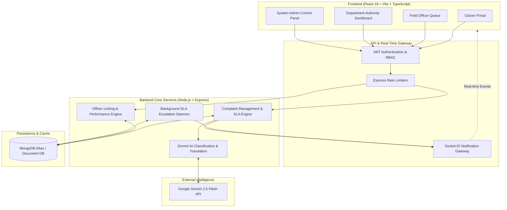

# UrbanPulse: AI-Powered Civic Complaint & Governance Platform

[](https://nodejs.org/)
[](https://reactjs.org/)
[](https://www.typescriptlang.org/)
[](https://vitejs.dev/)
[](https://www.mongodb.com/)
[](https://tailwindcss.com/)
[](https://ai.google.dev/)
[](https://socket.io/)
[](LICENSE)

**UrbanPulse** (GovAI Resolve) is an enterprise-grade civic grievance redressal and complaint governance platform. The system connects Citizens, Field Officers, Department Authorities, and Municipal Administrators through an automated, accountable, and transparent workflow powered by **Google Gemini 2.5 Flash AI** and real-time **Socket.IO** synchronization.

---

## 1. System Architecture



---

## 2. Key Features

- **Multi-Role RBAC**: 4 distinct roles with strict permission boundaries:
  - **Citizen**: Submit complaints, upload photos, track SLA status, receive real-time notifications, and submit post-resolution feedback.
  - **Field Officer**: Access assigned complaints, track individual resolution timers, submit photographic resolution evidence, and manage operational status.
  - **Department Authority**: Manage department queues, assign tasks to linked field officers, monitor officer performance metrics, and review resolution proof.
  - **System Administrator**: Manage departments, link officer user accounts to departmental members, inspect global audit logs, analyze heatmaps, and export sanitised reports.
- **AI Triage & Categorization**: Google Gemini 2.5 Flash analyzes natural language text to predict department, urgency, and recommended actions with automatic regional-to-English translation fallback.
- **Dynamic SLA Timers**: Automatic SLA calculation based on complaint priority (Urgent: 12h, High: 24h, Medium: 72h, Low: 168h) with background escalation for overdue tasks.
- **Geospatial Heatmap**: Interactive Leaflet map visualizing complaint density, urgency clusters, and geographic hot-spots.
- **Evidence-Based Resolution**: Enforces photo upload and operational remarks verification before an issue can transition to `Resolved`.
- **Real-Time Notifications**: WebSocket event broadcasting via Socket.IO for status transitions, officer assignments, and escalation alerts.

---

## 3. Technology Stack

| Layer | Technologies |
| :--- | :--- |
| **Frontend** | React 18, TypeScript, Vite, Tailwind CSS, Radix UI / Shadcn, Framer Motion, Leaflet, Lucide Icons |
| **Backend** | Node.js, Express.js (ESM), Mongoose, Socket.IO, Multer, JWT, Bcrypt |
| **Database** | MongoDB Atlas / MongoDB 6.0+ |
| **AI Integration** | Google Gemini 2.5 Flash (`@google/genai`) |
| **Testing** | Node.js Native Test Runner (`node:test`), Vitest, React Testing Library, Chrome DevTools Protocol |

---

## 4. Getting Started

### 4.1 Prerequisites
- **Node.js**: v18.0.0 or higher
- **npm**: v9.0.0 or higher
- **MongoDB**: A running local MongoDB instance or a free MongoDB Atlas connection string.

### 4.2 Installation

1. **Clone the repository:**
   ```bash
   git clone https://github.com/Mrgujjar8923/Urban-Pulse-n.git
   cd Urban-Pulse-n
   ```

2. **Install backend dependencies:**
   ```bash
   cd backend
   npm install
   ```

3. **Install frontend dependencies:**
   ```bash
   cd ../frontend
   npm install
   ```

---

## 5. Environment Configuration

### Backend (`backend/.env`)
Create a `.env` file in the `backend/` directory based on `backend/.env.example`:

```env
PORT=5000
NODE_ENV=development

# MongoDB Connection String
MONGO_URI=mongodb+srv://<username>:<password>@<cluster>.mongodb.net/<database>?retryWrites=true&w=majority
MONGO_DB_NAME=urbanpulse

# Security & Secrets
JWT_SECRET=your_jwt_secret_key_min_32_characters_here
JWT_EXPIRES_IN=7d

# Google Gemini API
GEMINI_API_KEY=your_gemini_api_key_here

# Client URL (for CORS and Socket.IO)
CLIENT_URL=http://localhost:8080
```

### Frontend (`frontend/.env`)
Create a `.env` file in the `frontend/` directory:

```env
VITE_API_URL=http://localhost:5000/api
```

---

## 6. Running the Application

### Start the Backend Server
```bash
cd backend
npm run dev
# Server starts on http://localhost:5000
```

### Start the Frontend Client
In a separate terminal:
```bash
cd frontend
npm run dev
# Frontend starts on http://localhost:8080
```

---

## 7. Running Tests

### Backend Test Suite
```bash
cd backend
npm test
# Executes all unit, integration, and security tests
```

### Frontend Test Suite
```bash
cd frontend
npm test
# Executes Vitest and React Testing Library suites
```

---

## 8. Role-Based Demo Accounts

For demonstration and testing purposes, standard pre-configured demo personas are supported:

| Role | Email | Password | Scope |
| :--- | :--- | :--- | :--- |
| **System Admin** | `admin@govai.gov` | `12345678` | System-wide administrative access |
| **Department Authority** | `water@demo.com` | `12345678` | Water Supply Authority overview & assignment |
| **Field Officer** | `water.officer@govai.gov` | `12345678` | Water Supply assigned field tasks & evidence |
| **Citizen Demo** | `citizen.demo@govai.gov` | `12345678` | Citizen complaint submission & tracking |

---

## 9. License

This project is licensed under the MIT License - see the [LICENSE](LICENSE) file for details.
